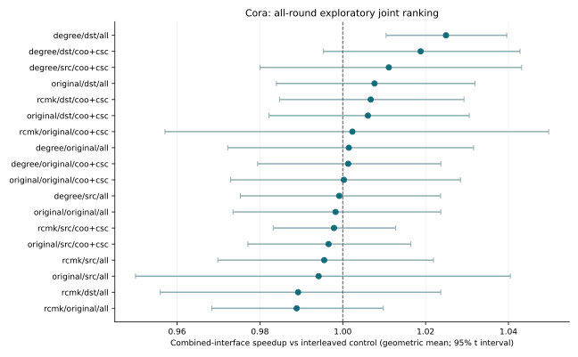
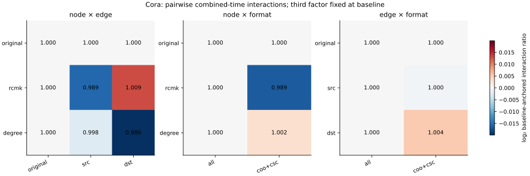
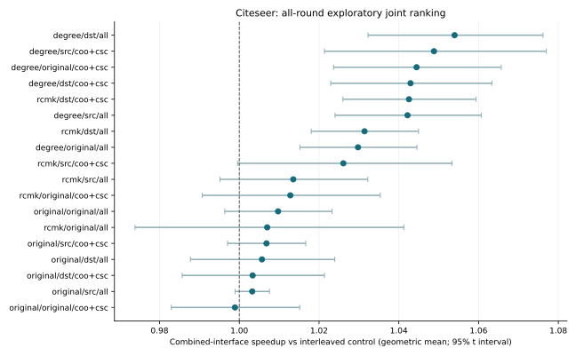
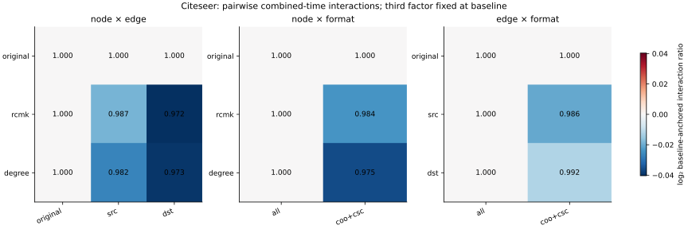
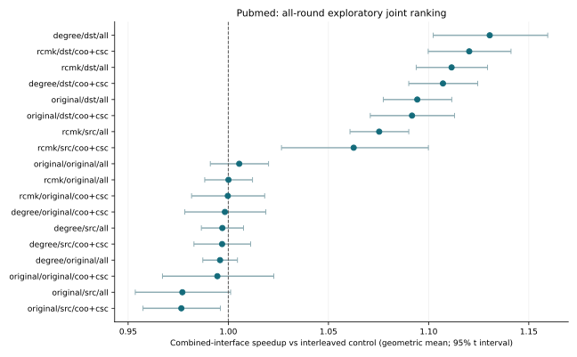
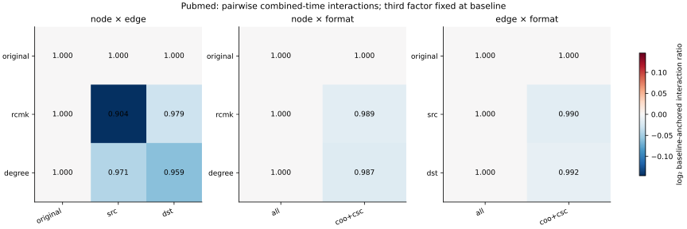

# Joint DGL GAT CPU tuning — milestone 3

## Question and experimental design

Does jointly selecting node order, edge order and a compatible sparse policy outperform combining independently selected settings? The primary objective is the **combined interface time** returning output rows in original logical node order. Raw full-forward latency is also ranked separately. This is a measured factorial experiment; no custom kernel, fusion, layout or predictive model is introduced.

Each dataset has **6 fresh-process rounds**, 5 warmups per block, and 20 timed repetitions per block. Rounds 1–3 select configurations; the remaining 3 rounds evaluate those choices without re-selection. All candidates are also measured in held-out rounds to provide exploratory rankings; the all-round best is explicitly separate from the discovery-selected winner.

Each round randomizes candidate order with a recorded seed. Every candidate has a warmed baseline control immediately before and after it. Relative latency divides the candidate median by the arithmetic mean of its bracketing control medians. Speedup is the reciprocal. Each control uses the same graph, features, weights and untouched official layer as the original/original/all configuration. Round-level geometric means of ratios determine rankings. Timed repetitions within a process are **not** treated as independent statistical trials.

## Findings for review

The exploratory winners and independently combined choices are listed below. Use the held-out intervals to assess whether different selections provide a repeatable advantage; selecting the smallest observed time alone is not enough.

| Dataset | Exploratory 6-round joint winner | Mean combined ms | Independent axes (all rounds) |
| --- | --- | --- | --- |
| cora | degree/dst/all | 3.9146 | degree/dst/coo+csc |
| citeseer | degree/dst/all | 7.7996 | degree/original/all |
| pubmed | degree/dst/all | 17.0736 | original/dst/all |

Held-out test below uses choices selected ONLY on the discovery rounds; these need not be the exploratory all-round winners.

| Dataset | Discovery joint choice | Discovery independent choice | Held-out joint advantage [95% CI] |
| --- | --- | --- | --- |
| cora | degree/dst/coo+csc | original/dst/all | 1.010× [0.940, 1.086] |
| citeseer | degree/dst/all | degree/src/all | 1.010× [0.952, 1.072] |
| pubmed | rcmk/dst/coo+csc | rcmk/dst/all | 1.015× [0.916, 1.125] |

## Environment and invariant workload

| Field | Value |
| --- | --- |
| cpu_model | INTEL(R) XEON(R) PLATINUM 8573C |
| logical_cpus | 5 |
| cpu_affinity | [0, 1, 2, 3, 4] |
| os | Linux-6.18.57-x86_64-with-glibc2.41 |
| python | 3.11.17 |
| dgl | 1.1.3 |
| torch | 2.2.2+cpu |
| torch_threads | 1 |
| torch_interop_threads | 1 |
| thread_environment | {'OMP_NUM_THREADS': '1', 'OMP_DYNAMIC': None, 'OMP_PROC_BIND': None, 'OMP_PLACES': None, 'MKL_NUM_THREADS': '1', 'OPENBLAS_NUM_THREADS': '1'} |
| git_commit | cd6d04549a2c24537b631e1d4170d9351bec597c |
| git_dirty | True |
| cgroup | {'cpu.max': '400000 100000', 'memory.max': '34359738368'} |

The commit above is the base commit; new module source hashes are recorded for every worker in RESULTS.json. The original annotated baseline, previous scripts, REPORT.md and MEASUREMENTS.json remain unchanged. Runtime dependencies, Dockerfile and uv.lock are unchanged. All performance measurements use the native locked environment; separate container checks validate reproducibility, not identical physical-CPU timing.

Official dataset topology and native feature width are fixed. Citation loaders use reorder=False. Remove all self-loops, then append exactly one loop per node. Canonical EIDs refer to this preprocessed graph. Four heads, eight output features/head, float32, bias enabled, no residual/activation, dropout zero, evaluation/inference mode, seed 0 and identical weight hashes across all cases/rounds per dataset. Sparse formats are fully materialized before validation/warmup/timing.

An exact EID-indexed topology check maps every reordered endpoint back to the original node IDs, preserving multiplicities and loops. Feature rows, new-to-old NIDs, EIDs and requested edge grouping are checked. Original EID order after node permutation uses official reorder_graph with edge_permute_algo="custom" and an identity edge permutation; DGL explicitly undoes node-induced EID reordering in this API. Outputs are restored with a precomputed inverse NID index_select, or a no-copy identity path when nodes are unchanged. Numerical equivalence uses untouched official GATConv, rtol=1e-4/atol=1e-5.

## Sparse compatibility pilot

All seven nonempty policies were tested on a small graph with isolated nodes before self-loop preprocessing and parallel edges. This is a compatibility test, not dataset performance. Allowed/materialized states before and after the full forward and exact errors are preserved in [PILOT.json](PILOT.json) and RESULTS.json.

| Policy | Status | Numerically equivalent | Observed failure |
| --- | --- | --- | --- |
| coo | unsupported | not evaluated (no output) | [06:50:53] /opt/dgl/src/graph/unit_graph.cc:1421: The graph have restricted sparse format coo , cannot create CSC matrix. |
| csr | unsupported | not evaluated (no output) | [06:50:53] /opt/dgl/src/graph/unit_graph.cc:1035: Check failed: fmt == SparseFormat::kCSC // fmt == SparseFormat::kCOO: In degree cannot be computed as neither CSC nor COO format is allowed for this graph. Please enable one of them at least. |
| csc | unsupported | not evaluated (no output) | [06:50:53] /opt/dgl/src/array/kernel.cc:231: SDDMM only supports CSR and COO formats |
| coo+csr | unsupported | not evaluated (no output) | [06:50:53] /opt/dgl/src/graph/unit_graph.cc:1421: The graph have restricted sparse format coo csr , cannot create CSC matrix. |
| coo+csc | supported | True | — |
| csr+csc | unsupported | not evaluated (no output) | [06:50:53] /opt/dgl/src/array/kernel.cc:231: SDDMM only supports CSR and COO formats |
| coo+csr+csc | supported | True | — |

CSR+CSC is excluded if the pilot fails; no extra COO permission or bypass of the stock in-degree check is introduced. Format permissions and available sparse tensors do not prove which compiled kernel or representation each operator dispatches to.

## Valid configuration matrix

Cross original/RCMK/ascending total-degree nodes, original-EID/src/dst edges and only pilot-approved policies. Degree ties use original node IDs. Exact duplicates are identified only when allowed/materialized representations (including sparse index and EID-map hashes), input features, NIDs and EIDs are all identical. These aliases reuse a representative measurement. Different permissions are retained even when shared compressed tensors match: similar timings or permissions alone do not establish ineffective kernel dispatch.

| Node | Edge | All | COO+CSC | CSR+CSC |
| --- | --- | --- | --- | --- |
| original | original | valid | valid | excluded by pilot |
| original | src | valid | valid | excluded by pilot |
| original | dst | valid | valid | excluded by pilot |
| rcmk | original | valid | valid | excluded by pilot |
| rcmk | src | valid | valid | excluded by pilot |
| rcmk | dst | valid | valid | excluded by pilot |
| degree | original | valid | valid | excluded by pilot |
| degree | src | valid | valid | excluded by pilot |
| degree | dst | valid | valid | excluded by pilot |

## Timing and amortization definitions

A single continuous sample records t0 → complete synchronous official forward → t1 → restore original output order → t2. Forward=t1−t0, restoration=t2−t1, combined=t2−t0. No graph setup, feature generation, serialization, correctness assertions or inverse-map construction is timed. Clock reads, Python dispatch, allocations and ordinary object lifetimes remain part of the respective interface costs. The identity restoration path includes its small Python/clock overhead and does not copy data. Every block warms both forward and restoration.

One-time preparation measures official node/edge reordering (including feature permutation), format restriction/materialization and inverse-map construction separately in every fresh process. Dataset loading/normalization and model initialization are shared setup and excluded from differential amortization. Validation/hashing is research overhead and excluded. Break-even calls = ceil(mean incremental preparation ms / mean bracketing-control combined-time saving ms), only if mean saving is positive. Positive-round count and per-round break-even values reveal unstable savings; point estimates are not guarantees.

Intervals use Student-t on the mean log ratio across independent rounds and then exponentiate. They are exploratory small-sample intervals, not multiple-comparison-adjusted significance claims. Held-out joint-vs-independent ratios use matching rounds and their local control normalization. A ratio above one favors the joint choice.

## Cora

Nodes: 2708; dataset edges: 10556; edges after self-loops: 13264; native feature width: 1433.
Maximum absolute reference error: 7.45e-09. Control after/before ratio: median 1.000, range 0.909–1.118.

### Joint versus independent selection

Independent selection minimizes each one-factor axis while holding the other two factors at original/original/all, then combines the selected values. Joint selection searches the complete valid grid. Exact aliases are resolved before comparing choices.

- Exploratory all-round forward_ms: fastest degree/dst/all; independent-axis combination degree/dst/coo+csc; different=True. This comparison uses all rounds for selection and is not held-out confirmation.
- Exploratory all-round combined_ms: fastest degree/dst/all; independent-axis combination degree/dst/coo+csc; different=True. This comparison uses all rounds for selection and is not held-out confirmation.

| Objective | Discovery joint choice | Discovery independent combination | Different? | Held-out joint/independent speedup [95% CI] |
| --- | --- | --- | --- | --- |
| forward_ms | degree/dst/coo+csc | degree/dst/all | True | 0.974× [0.938, 1.012] |
| combined_ms | degree/dst/coo+csc | original/dst/all | True | 1.010× [0.940, 1.086] |

**Recorded representation evidence** (original node and edge order):

| Policy | Allowed | Materialized | Shared sparse tensor/EID-map hashes match all-policy |
| --- | --- | --- | --- |
| all | ['coo', 'csc', 'csr'] | ['coo', 'csr', 'csc'] | {'coo': True, 'csc': True, 'csr': True} |
| coo+csc | ['coo', 'csc'] | ['coo', 'csc'] | {'coo': True, 'csc': True} |

Shared tensors can match while permissions differ; without dispatch traces this is not proof of equal kernel execution, so both policies remain measured candidates.

The selections differ, but the held-out interval includes one; this run does not establish a reliable speed advantage.

### Combined-interface ranking (all rounds; exploratory)

| Rank | Node / edge / policy | Forward ms | Restore ms | Combined ms | Between-round SD ms | Speedup [95% CI] |
| --- | --- | --- | --- | --- | --- | --- |
| 1 | degree/dst/all | 3.8671 | 0.0478 | 3.9146 | 0.0595 | 1.025× [1.010, 1.040] |
| 2 | degree/dst/coo+csc | 3.9290 | 0.0480 | 3.9763 | 0.1028 | 1.019× [0.995, 1.043] |
| 3 | degree/src/coo+csc | 3.9479 | 0.0473 | 3.9988 | 0.0759 | 1.011× [0.980, 1.043] |
| 4 | original/dst/all | 3.9945 | 0.0010 | 3.9956 | 0.0952 | 1.008× [0.984, 1.032] |
| 5 | rcmk/dst/coo+csc | 3.9477 | 0.0481 | 3.9980 | 0.0486 | 1.007× [0.985, 1.029] |
| 6 | original/dst/coo+csc | 4.0131 | 0.0010 | 4.0140 | 0.0885 | 1.006× [0.982, 1.031] |
| 7 | rcmk/original/coo+csc | 4.0003 | 0.0481 | 4.0689 | 0.1158 | 1.002× [0.957, 1.050] |
| 8 | degree/original/all | 3.9717 | 0.0476 | 4.0218 | 0.0686 | 1.001× [0.972, 1.032] |
| 9 | degree/original/coo+csc | 3.9290 | 0.0476 | 3.9801 | 0.0581 | 1.001× [0.979, 1.024] |
| 10 | original/original/coo+csc | 4.0176 | 0.0011 | 4.0186 | 0.1386 | 1.000× [0.973, 1.028] |
| 11 | degree/src/all | 4.0113 | 0.0486 | 4.0637 | 0.0933 | 0.999× [0.975, 1.024] |
| 12 | original/original/all | 4.0159 | 0.0010 | 4.0169 | 0.0814 | 0.998× [0.973, 1.024] |
| 13 | rcmk/src/coo+csc | 4.0009 | 0.0475 | 4.0545 | 0.1196 | 0.998× [0.983, 1.013] |
| 14 | original/src/coo+csc | 4.0587 | 0.0010 | 4.0598 | 0.0687 | 0.997× [0.977, 1.016] |
| 15 | rcmk/src/all | 3.9830 | 0.0482 | 4.0330 | 0.0774 | 0.996× [0.970, 1.022] |
| 16 | original/src/all | 4.0547 | 0.0011 | 4.0558 | 0.1561 | 0.994× [0.950, 1.040] |
| 17 | rcmk/dst/all | 4.0171 | 0.0485 | 4.0679 | 0.1458 | 0.989× [0.956, 1.024] |
| 18 | rcmk/original/all | 4.0105 | 0.0485 | 4.0602 | 0.0793 | 0.989× [0.968, 1.010] |

Times above are means of round medians; ranks use geometric mean normalized ratios. Complete per-round medians, means, SDs and raw samples are in RESULTS.json. ANALYSIS.json also contains the independent forward-only ranking.



### Pairwise interactions

Each table fixes the third factor at baseline and reports I(a,b)=T(a,b)×T(0,0)/(T(a,0)×T(0,b)), using normalized combined times within each round. One means multiplicative separability; below one means the pair costs less than the product of its isolated ratios. These are descriptive interaction contrasts, not a fitted performance model or kernel-cause claim. They do not capture all three-way interactions.

**node × edge**

| Setting | original | src | dst |
| --- | --- | --- | --- |
| original | 1.000 | 1.000 | 1.000 |
| rcmk | 1.000 | 0.989 | 1.009 |
| degree | 1.000 | 0.998 | 0.986 |

**node × format**

| Setting | all | coo+csc |
| --- | --- | --- |
| original | 1.000 | 1.000 |
| rcmk | 1.000 | 0.989 |
| degree | 1.000 | 1.002 |

**edge × format**

| Setting | all | coo+csc |
| --- | --- | --- |
| original | 1.000 | 1.000 |
| src | 1.000 | 1.000 |
| dst | 1.000 | 1.004 |



### One-time cost and amortization

| Configuration | Mean preparation ms | Mean combined saving ms | Positive rounds | Point-estimate break-even calls |
| --- | --- | --- | --- | --- |
| degree/dst/all | 2.093 | 0.0974 | 6/6 | 22 |
| degree/dst/coo+csc | 2.135 | 0.0746 | 4/6 | 29 |
| degree/src/coo+csc | 2.100 | 0.0452 | 4/6 | 47 |
| original/dst/all | 1.137 | 0.0300 | 4/6 | 38 |
| rcmk/dst/coo+csc | 2.673 | 0.0276 | 4/6 | 97 |
| original/dst/coo+csc | 1.060 | 0.0237 | 4/6 | 45 |
| rcmk/original/coo+csc | 3.486 | 0.0094 | 4/6 | 372 |
| degree/original/all | 2.722 | 0.0059 | 4/6 | 461 |
| degree/original/coo+csc | 2.484 | 0.0052 | 3/6 | 480 |
| original/original/coo+csc | 0.065 | -0.0004 | 4/6 | never (mean saving ≤0) |
| degree/src/all | 2.151 | -0.0037 | 4/6 | never (mean saving ≤0) |
| original/original/all | 0.000 | -0.0069 | 3/6 | control |
| rcmk/src/coo+csc | 2.769 | -0.0087 | 3/6 | never (mean saving ≤0) |
| original/src/coo+csc | 1.004 | -0.0135 | 4/6 | never (mean saving ≤0) |
| rcmk/src/all | 3.007 | -0.0183 | 3/6 | never (mean saving ≤0) |
| original/src/all | 1.432 | -0.0255 | 2/6 | never (mean saving ≤0) |
| rcmk/dst/all | 2.851 | -0.0453 | 2/6 | never (mean saving ≤0) |
| rcmk/original/all | 4.042 | -0.0449 | 1/6 | never (mean saving ≤0) |


Exact representation/input duplicates: **none**. All nonidentical policies remain candidates; a similar latency is not grounds for claiming equivalent dispatch.

## Citeseer

Nodes: 3327; dataset edges: 9228; edges after self-loops: 12431; native feature width: 3703.
Maximum absolute reference error: 3.73e-09. Control after/before ratio: median 1.007, range 0.894–1.048.

### Joint versus independent selection

Independent selection minimizes each one-factor axis while holding the other two factors at original/original/all, then combines the selected values. Joint selection searches the complete valid grid. Exact aliases are resolved before comparing choices.

- Exploratory all-round forward_ms: fastest degree/dst/all; independent-axis combination degree/original/all; different=True. This comparison uses all rounds for selection and is not held-out confirmation.
- Exploratory all-round combined_ms: fastest degree/dst/all; independent-axis combination degree/original/all; different=True. This comparison uses all rounds for selection and is not held-out confirmation.

| Objective | Discovery joint choice | Discovery independent combination | Different? | Held-out joint/independent speedup [95% CI] |
| --- | --- | --- | --- | --- |
| forward_ms | degree/dst/all | degree/src/all | True | 1.011× [0.956, 1.068] |
| combined_ms | degree/dst/all | degree/src/all | True | 1.010× [0.952, 1.072] |

**Recorded representation evidence** (original node and edge order):

| Policy | Allowed | Materialized | Shared sparse tensor/EID-map hashes match all-policy |
| --- | --- | --- | --- |
| all | ['coo', 'csc', 'csr'] | ['coo', 'csr', 'csc'] | {'coo': True, 'csc': True, 'csr': True} |
| coo+csc | ['coo', 'csc'] | ['coo', 'csc'] | {'coo': True, 'csc': True} |

Shared tensors can match while permissions differ; without dispatch traces this is not proof of equal kernel execution, so both policies remain measured candidates.

The selections differ, but the held-out interval includes one; this run does not establish a reliable speed advantage.

### Combined-interface ranking (all rounds; exploratory)

| Rank | Node / edge / policy | Forward ms | Restore ms | Combined ms | Between-round SD ms | Speedup [95% CI] |
| --- | --- | --- | --- | --- | --- | --- |
| 1 | degree/dst/all | 7.7394 | 0.0564 | 7.7996 | 0.1056 | 1.054× [1.032, 1.076] |
| 2 | degree/src/coo+csc | 7.8027 | 0.0549 | 7.8631 | 0.1139 | 1.049× [1.021, 1.077] |
| 3 | degree/original/coo+csc | 7.8272 | 0.0547 | 7.8830 | 0.1155 | 1.044× [1.024, 1.066] |
| 4 | degree/dst/coo+csc | 7.8087 | 0.0551 | 7.8657 | 0.1513 | 1.043× [1.023, 1.063] |
| 5 | rcmk/dst/coo+csc | 7.8536 | 0.0587 | 7.9146 | 0.1155 | 1.043× [1.026, 1.059] |
| 6 | degree/src/all | 7.8066 | 0.0550 | 7.8653 | 0.0750 | 1.042× [1.024, 1.061] |
| 7 | rcmk/dst/all | 7.9660 | 0.0549 | 8.0260 | 0.1510 | 1.031× [1.018, 1.045] |
| 8 | degree/original/all | 7.9117 | 0.0559 | 7.9720 | 0.1669 | 1.030× [1.015, 1.045] |
| 9 | rcmk/src/coo+csc | 8.0486 | 0.0566 | 8.1063 | 0.2261 | 1.026× [1.000, 1.053] |
| 10 | rcmk/src/all | 8.1491 | 0.0572 | 8.2104 | 0.2696 | 1.014× [0.995, 1.032] |
| 11 | rcmk/original/coo+csc | 8.1037 | 0.0554 | 8.1614 | 0.1123 | 1.013× [0.991, 1.035] |
| 12 | original/original/all | 8.1526 | 0.0010 | 8.1538 | 0.1017 | 1.010× [0.996, 1.023] |
| 13 | rcmk/original/all | 8.1506 | 0.0574 | 8.2114 | 0.1702 | 1.007× [0.974, 1.041] |
| 14 | original/src/coo+csc | 8.1833 | 0.0010 | 8.1843 | 0.1155 | 1.007× [0.997, 1.017] |
| 15 | original/dst/all | 8.2352 | 0.0009 | 8.2362 | 0.1927 | 1.006× [0.988, 1.024] |
| 16 | original/dst/coo+csc | 8.2504 | 0.0010 | 8.2514 | 0.2372 | 1.003× [0.986, 1.021] |
| 17 | original/src/all | 8.2367 | 0.0009 | 8.2377 | 0.1266 | 1.003× [0.999, 1.008] |
| 18 | original/original/coo+csc | 8.2729 | 0.0010 | 8.2739 | 0.2739 | 0.999× [0.983, 1.015] |

Times above are means of round medians; ranks use geometric mean normalized ratios. Complete per-round medians, means, SDs and raw samples are in RESULTS.json. ANALYSIS.json also contains the independent forward-only ranking.



### Pairwise interactions

Each table fixes the third factor at baseline and reports I(a,b)=T(a,b)×T(0,0)/(T(a,0)×T(0,b)), using normalized combined times within each round. One means multiplicative separability; below one means the pair costs less than the product of its isolated ratios. These are descriptive interaction contrasts, not a fitted performance model or kernel-cause claim. They do not capture all three-way interactions.

**node × edge**

| Setting | original | src | dst |
| --- | --- | --- | --- |
| original | 1.000 | 1.000 | 1.000 |
| rcmk | 1.000 | 0.987 | 0.972 |
| degree | 1.000 | 0.982 | 0.973 |

**node × format**

| Setting | all | coo+csc |
| --- | --- | --- |
| original | 1.000 | 1.000 |
| rcmk | 1.000 | 0.984 |
| degree | 1.000 | 0.975 |

**edge × format**

| Setting | all | coo+csc |
| --- | --- | --- |
| original | 1.000 | 1.000 |
| src | 1.000 | 0.986 |
| dst | 1.000 | 0.992 |



### One-time cost and amortization

| Configuration | Mean preparation ms | Mean combined saving ms | Positive rounds | Point-estimate break-even calls |
| --- | --- | --- | --- | --- |
| degree/dst/all | 2.368 | 0.4210 | 6/6 | 6 |
| degree/src/coo+csc | 2.361 | 0.3843 | 5/6 | 7 |
| degree/original/coo+csc | 2.591 | 0.3514 | 6/6 | 8 |
| degree/dst/coo+csc | 2.257 | 0.3372 | 6/6 | 7 |
| rcmk/dst/coo+csc | 3.284 | 0.3365 | 6/6 | 10 |
| degree/src/all | 2.386 | 0.3322 | 6/6 | 8 |
| rcmk/dst/all | 3.321 | 0.2535 | 6/6 | 14 |
| degree/original/all | 3.099 | 0.2366 | 6/6 | 14 |
| rcmk/src/coo+csc | 3.107 | 0.2127 | 5/6 | 15 |
| rcmk/src/all | 3.255 | 0.1136 | 4/6 | 29 |
| rcmk/original/coo+csc | 3.753 | 0.1041 | 3/6 | 37 |
| original/original/all | 0.000 | 0.0792 | 5/6 | control |
| rcmk/original/all | 5.187 | 0.0573 | 5/6 | 91 |
| original/src/coo+csc | 1.664 | 0.0560 | 4/6 | 30 |
| original/dst/all | 1.288 | 0.0465 | 4/6 | 28 |
| original/dst/coo+csc | 1.190 | 0.0256 | 4/6 | 47 |
| original/src/all | 1.533 | 0.0265 | 5/6 | 58 |
| original/original/coo+csc | 0.085 | -0.0105 | 3/6 | never (mean saving ≤0) |


Exact representation/input duplicates: **none**. All nonidentical policies remain candidates; a similar latency is not grounds for claiming equivalent dispatch.

## Pubmed

Nodes: 19717; dataset edges: 88651; edges after self-loops: 108365; native feature width: 500.
Maximum absolute reference error: 1.86e-08. Control after/before ratio: median 1.001, range 0.940–1.056.

### Joint versus independent selection

Independent selection minimizes each one-factor axis while holding the other two factors at original/original/all, then combines the selected values. Joint selection searches the complete valid grid. Exact aliases are resolved before comparing choices.

- Exploratory all-round forward_ms: fastest degree/dst/all; independent-axis combination rcmk/dst/all; different=True. This comparison uses all rounds for selection and is not held-out confirmation.
- Exploratory all-round combined_ms: fastest degree/dst/all; independent-axis combination original/dst/all; different=True. This comparison uses all rounds for selection and is not held-out confirmation.

| Objective | Discovery joint choice | Discovery independent combination | Different? | Held-out joint/independent speedup [95% CI] |
| --- | --- | --- | --- | --- |
| forward_ms | rcmk/dst/all | rcmk/dst/all | False | 1.000× [1.000, 1.000] |
| combined_ms | rcmk/dst/coo+csc | rcmk/dst/all | True | 1.015× [0.916, 1.125] |

**Recorded representation evidence** (original node and edge order):

| Policy | Allowed | Materialized | Shared sparse tensor/EID-map hashes match all-policy |
| --- | --- | --- | --- |
| all | ['coo', 'csc', 'csr'] | ['coo', 'csr', 'csc'] | {'coo': True, 'csc': True, 'csr': True} |
| coo+csc | ['coo', 'csc'] | ['coo', 'csc'] | {'coo': True, 'csc': True} |

Shared tensors can match while permissions differ; without dispatch traces this is not proof of equal kernel execution, so both policies remain measured candidates.

The selections differ, but the held-out interval includes one; this run does not establish a reliable speed advantage.

### Combined-interface ranking (all rounds; exploratory)

| Rank | Node / edge / policy | Forward ms | Restore ms | Combined ms | Between-round SD ms | Speedup [95% CI] |
| --- | --- | --- | --- | --- | --- | --- |
| 1 | degree/dst/all | 16.7016 | 0.3461 | 17.0736 | 0.3168 | 1.130× [1.102, 1.159] |
| 2 | rcmk/dst/coo+csc | 16.7745 | 0.3740 | 17.1971 | 0.4350 | 1.120× [1.100, 1.141] |
| 3 | rcmk/dst/all | 16.5617 | 0.3689 | 17.0732 | 0.3041 | 1.111× [1.094, 1.129] |
| 4 | degree/dst/coo+csc | 16.8566 | 0.3596 | 17.2537 | 0.1814 | 1.107× [1.090, 1.125] |
| 5 | original/dst/all | 17.5223 | 0.0014 | 17.5634 | 0.1835 | 1.094× [1.077, 1.112] |
| 6 | original/dst/coo+csc | 17.5598 | 0.0014 | 17.5892 | 0.3747 | 1.092× [1.071, 1.113] |
| 7 | rcmk/src/all | 17.3293 | 0.3623 | 17.7443 | 0.2425 | 1.075× [1.061, 1.090] |
| 8 | rcmk/src/coo+csc | 17.5267 | 0.3735 | 17.9655 | 0.3626 | 1.063× [1.027, 1.100] |
| 9 | original/original/all | 19.1330 | 0.0014 | 19.1660 | 0.1548 | 1.005× [0.991, 1.020] |
| 10 | rcmk/original/all | 18.7533 | 0.3757 | 19.1550 | 0.1953 | 1.000× [0.988, 1.012] |
| 11 | rcmk/original/coo+csc | 18.7998 | 0.3655 | 19.2215 | 0.2564 | 1.000× [0.982, 1.018] |
| 12 | degree/original/coo+csc | 18.6462 | 0.3604 | 19.0640 | 0.3790 | 0.998× [0.978, 1.019] |
| 13 | degree/src/all | 18.9693 | 0.3661 | 19.4285 | 0.3481 | 0.997× [0.987, 1.008] |
| 14 | degree/src/coo+csc | 18.6487 | 0.3627 | 19.0903 | 0.2455 | 0.997× [0.983, 1.011] |
| 15 | degree/original/all | 18.7977 | 0.3752 | 19.2295 | 0.2810 | 0.996× [0.987, 1.005] |
| 16 | original/original/coo+csc | 19.1507 | 0.0014 | 19.1903 | 0.5593 | 0.995× [0.967, 1.023] |
| 17 | original/src/all | 19.6679 | 0.0014 | 19.7011 | 0.5082 | 0.977× [0.954, 1.001] |
| 18 | original/src/coo+csc | 19.6197 | 0.0015 | 19.6225 | 0.3998 | 0.977× [0.957, 0.996] |

Times above are means of round medians; ranks use geometric mean normalized ratios. Complete per-round medians, means, SDs and raw samples are in RESULTS.json. ANALYSIS.json also contains the independent forward-only ranking.



### Pairwise interactions

Each table fixes the third factor at baseline and reports I(a,b)=T(a,b)×T(0,0)/(T(a,0)×T(0,b)), using normalized combined times within each round. One means multiplicative separability; below one means the pair costs less than the product of its isolated ratios. These are descriptive interaction contrasts, not a fitted performance model or kernel-cause claim. They do not capture all three-way interactions.

**node × edge**

| Setting | original | src | dst |
| --- | --- | --- | --- |
| original | 1.000 | 1.000 | 1.000 |
| rcmk | 1.000 | 0.904 | 0.979 |
| degree | 1.000 | 0.971 | 0.959 |

**node × format**

| Setting | all | coo+csc |
| --- | --- | --- |
| original | 1.000 | 1.000 |
| rcmk | 1.000 | 0.989 |
| degree | 1.000 | 0.987 |

**edge × format**

| Setting | all | coo+csc |
| --- | --- | --- |
| original | 1.000 | 1.000 |
| src | 1.000 | 0.990 |
| dst | 1.000 | 0.992 |



### One-time cost and amortization

| Configuration | Mean preparation ms | Mean combined saving ms | Positive rounds | Point-estimate break-even calls |
| --- | --- | --- | --- | --- |
| degree/dst/all | 12.721 | 2.2272 | 6/6 | 6 |
| rcmk/dst/coo+csc | 16.174 | 2.0677 | 6/6 | 8 |
| rcmk/dst/all | 17.127 | 1.9008 | 6/6 | 10 |
| degree/dst/coo+csc | 11.807 | 1.8503 | 6/6 | 7 |
| original/dst/all | 7.301 | 1.6581 | 6/6 | 5 |
| original/dst/coo+csc | 6.294 | 1.6098 | 6/6 | 4 |
| rcmk/src/all | 15.571 | 1.3360 | 6/6 | 12 |
| rcmk/src/coo+csc | 14.884 | 1.1265 | 6/6 | 14 |
| original/original/all | 0.000 | 0.1049 | 4/6 | control |
| rcmk/original/all | 20.252 | 0.0031 | 3/6 | 6535 |
| rcmk/original/coo+csc | 19.035 | -0.0057 | 5/6 | never (mean saving ≤0) |
| degree/original/coo+csc | 14.450 | -0.0349 | 3/6 | never (mean saving ≤0) |
| degree/src/all | 11.211 | -0.0586 | 2/6 | never (mean saving ≤0) |
| degree/src/coo+csc | 11.097 | -0.0574 | 3/6 | never (mean saving ≤0) |
| degree/original/all | 16.080 | -0.0796 | 3/6 | never (mean saving ≤0) |
| original/original/coo+csc | 0.080 | -0.1101 | 3/6 | never (mean saving ≤0) |
| original/src/all | 5.807 | -0.4562 | 1/6 | never (mean saving ≤0) |
| original/src/coo+csc | 5.129 | -0.4626 | 0/6 | never (mean saving ≤0) |


Exact representation/input duplicates: **none**. All nonidentical policies remain candidates; a similar latency is not grounds for claiming equivalent dispatch.

## Reddit

**skipped_memory**: Fixed four-head full-graph workload and joint graph matrix exceed 70% safety budget; no feature/head reduction or synthetic substitution
Single-case estimate: 29.53 GiB; resident joint-matrix sizing estimate: 35.44 GiB; safety budget: 18.26 GiB.
These are conservative allocation estimates, not measured peaks; storage sharing can reduce the matrix footprint. The single-case estimate independently exceeds the safety budget. All joint configurations were skipped before graph loading. The fixed four-head workload was not replaced with a smaller-head or synthetic workload.

## Limitations and reproduction

Only these graph datasets, one fixed model shape/seed and one shared CPU allocation are studied. Small round counts and shared-host scheduling/frequency variation limit generalization. Randomization/interleaved controls reduce but cannot eliminate drift or cache/carryover effects. Only one process measures at a time; configurations/graphs remain resident within a round. Controls use one original graph, so cache footprints need not match reordered graphs. Full-forward timings cannot attribute changes to linear projection, SDDMM, softmax or aggregation separately. No profiler establishes kernel dispatch. Held-out comparisons avoid selecting winners on their own validation results; exploratory full-grid rankings still have selection bias. Amortization assumes repeated inference on a fixed graph and stable average savings; topology changes, allocator effects, preprocessing memory and online conversion can change the tradeoff. Preparation order is fixed rather than randomized; its cost estimates also depend on allocator/cache state. Docker reproduces software dependencies, not identical hardware performance.

Run from the repository root. Dependencies and versions stay in the existing uv.lock. Plot rendering uses Matplotlib 3.10.8 separately from the benchmark environment.

```sh
export DGLBACKEND=pytorch OMP_NUM_THREADS=1 MKL_NUM_THREADS=1 OPENBLAS_NUM_THREADS=1
export UV_CACHE_DIR=/workspace/.cache/uv
uv run --frozen python benchmarks/joint_tuning/tests.py
uv run --frozen python benchmarks/joint_tuning/run.py --datasets cora citeseer pubmed reddit \
  --rounds 6 --discovery-rounds 3 --warmup 5 --repetitions 20 --threads 1 --seed 0 --order-seed 20261104
uv run --frozen python benchmarks/joint_tuning/report.py
MPLCONFIGDIR=/tmp/dgl-joint-mpl python benchmarks/joint_tuning/plots.py
```

PILOT.json contains exact compatibility errors and materialized states. RESULTS.json preserves all worker records, controls, raw forward/restoration/combined samples, permutations/representations as hashes and provenance. ANALYSIS.json contains rankings, selection decisions, uncertainty and algebraic interaction/amortization summaries. No dataset downloads or virtual environments are included in this module.
