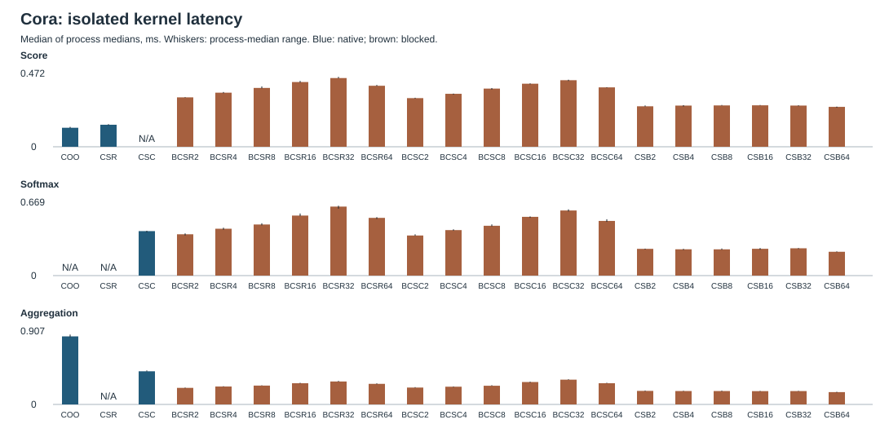
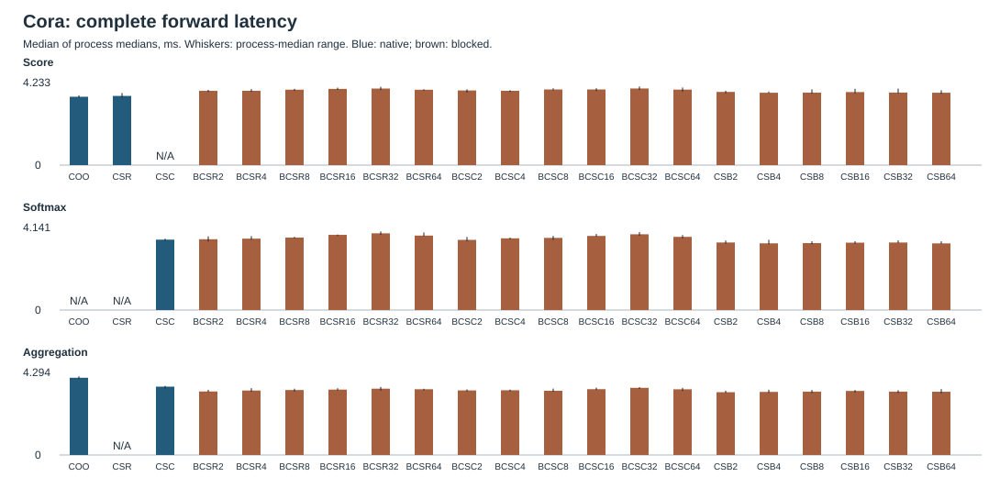
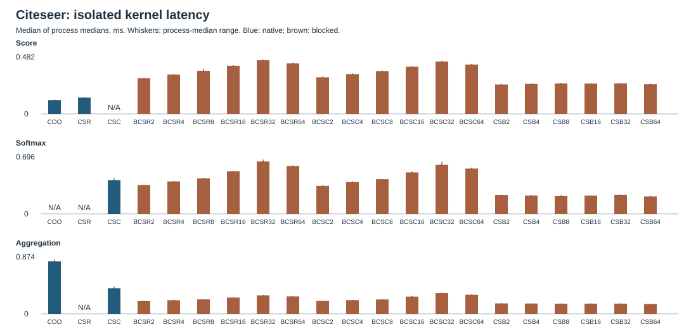
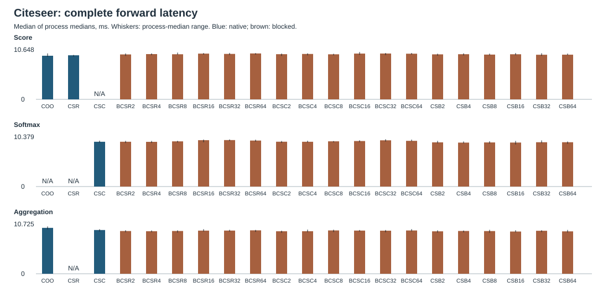
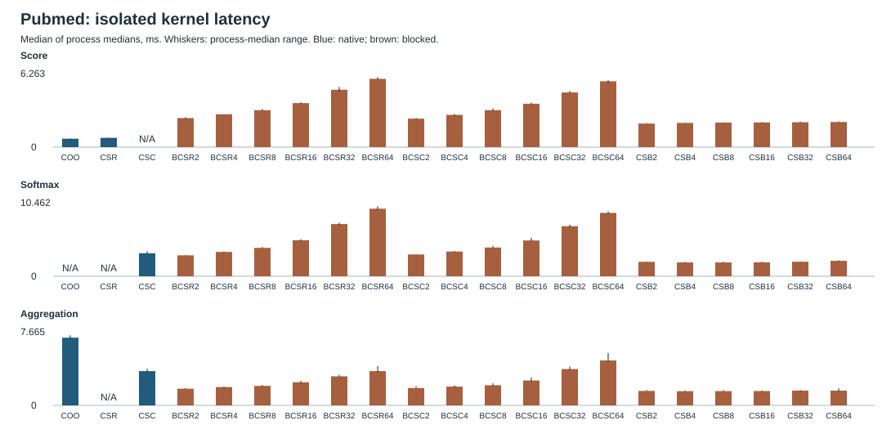
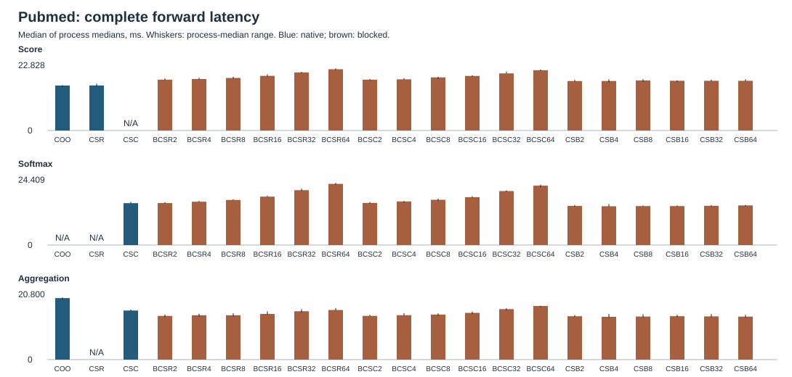

# Milestone 7: native DGL versus blocked sparse kernels

177 supported dataset/kernel/format substitutions validated; 85,680 sparse timing observations and 2,880 preliminary forward observations. Warmups and conversion measurements are retained separately.

## Preliminary: annotated versus imported GATConv

The full class AST and resolved forward dependencies matched. Output and EID-ordered attention were bitwise equal on the same pre-materialized graph, features and exact state_dict. The imported official layer remains the whole-forward reference.

Latency is the median of process medians, in ms. Ratio is annotated/imported latency. The ratio is the geometric mean of paired process ratios, not the ratio of the displayed medians. Equivalence requires the paired 90% t interval on the log ratio to lie wholly within the predefined [0.97, 1.03] band (TOST at 5% per dataset).

| Dataset | Imported ms (round range) | Annotated ms (round range) | Ratio | 95% CI | 90% CI | Decision |
|---|---|---|---:|---|---|---|
| cora | 3.69597 (3.58636–3.91336) | 3.67322 (3.61148–3.81426) | 0.99879 | [0.98197, 1.01590] | [0.98529, 1.01247] | equivalent |
| citeseer | 9.55133 (9.47441–10.12822) | 9.60344 (9.41345–10.29891) | 1.00490 | [0.99624, 1.01364] | [0.99796, 1.01189] | equivalent |
| pubmed | 16.57916 (15.67932–18.08673) | 16.62468 (15.80016–17.84938) | 0.99554 | [0.98244, 1.00881] | [0.98503, 1.00616] | equivalent |

Order diagnostic: cora annotated/imported 0.9878 when imported ran first, 1.0050 when annotated ran first; citeseer annotated/imported 0.9981 when imported ran first, 1.0014 when annotated ran first; pubmed annotated/imported 0.9965 when imported ran first, 1.0145 when annotated ran first. Raw round ratios are in ANALYSIS.json.

## Native dispatch and benchmark contract

DGL 1.1.3 native GSDDMM supports COO/CSR; destination edge softmax uses CSC; GSpMM supports COO/CSC. Verified against [pinned DGL source](https://raw.githubusercontent.com/dmlc/dgl/v1.1.3/src/array/kernel.cc) and successful sole-format views with exact EID checks and unchanged masks. This is not a C++ stack trace.

Unsupported: score/CSC, softmax/COO, softmax/CSR, aggregation/CSR. No fallback or timings for these cells.

One sparse stage changes at a time; other stages use Milestone 5's fixed DGL pipeline. Score includes LeakyReLU: native calls DGL then PyTorch; custom fuses activation inside C++. Native views use 64-bit indices and blocked layouts retain Milestone 6's 32-bit representation. Contrasts compare implementation stacks, not just blocking. Tile size is unrelated to attention head tiling.

All datasets retain exact Milestone 5 features, seed-0 weights and canonical EIDs. No coalescing or node reorder. Self-loop policy: remove existing loops, append one per node. Four heads, eight channels/head, FP32, no dropout, inference mode, one pinned CPU.

## Observed winners

| Dataset | Stage | Fastest isolated (ms) | Fastest substituted forward (ms) |
|---|---|---|---|
| cora | score | COO (0.12225) | COO (3.50503) |
| cora | softmax | CSB64 (0.21731) | CSB64 (3.34359) |
| cora | aggregation | CSB64 (0.15215) | CSB2 (3.26598) |
| citeseer | score | COO (0.11649) | COO (9.34465) |
| citeseer | softmax | CSB64 (0.21273) | CSB4 (9.18364) |
| citeseer | aggregation | CSB64 (0.15018) | CSB16 (9.11529) |
| pubmed | score | COO (0.71307) | COO (15.72506) |
| pubmed | softmax | CSB8 (1.96363) | CSB4 (14.51579) |
| pubmed | aggregation | CSB4 (1.48028) | CSB4 (13.65352) |

Untouched imported GATConv in the sparse sessions (ms): cora 3.79251, citeseer 9.62541, pubmed 16.06353.

## Every format and tile size

Cells give isolated / substituted forward ms. ANALYSIS.json includes variability and all paired speedups and CIs.

| Dataset | Format | Score | Softmax | Aggregation | Index KiB | Build ms |
|---|---|---:|---:|---:|---:|---:|
| cora | COO | 0.12225 / 3.50503 | Unsupported | 0.84080 / 4.01744 | 207.2 | 0.02306 |
| cora | CSR | 0.14164 / 3.54730 | Unsupported | Unsupported | 228.4 | 0.05086 |
| cora | CSC | Unsupported | 0.40563 / 3.53147 | 0.40953 / 3.55501 | 228.4 | 0.05232 |
| cora | BCSR2 | 0.31770 / 3.80909 | 0.37686 / 3.55200 | 0.20467 / 3.30385 | 238.5 | 1.25321 |
| cora | BCSR4 | 0.34787 / 3.81135 | 0.42731 / 3.58158 | 0.22128 / 3.35305 | 297.1 | 1.25581 |
| cora | BCSR8 | 0.37837 / 3.86759 | 0.46600 / 3.63536 | 0.23278 / 3.37921 | 413.5 | 1.25553 |
| cora | BCSR16 | 0.41630 / 3.90799 | 0.54738 / 3.77087 | 0.26181 / 3.40114 | 597.8 | 1.18772 |
| cora | BCSR32 | 0.44183 / 3.92606 | 0.62928 / 3.84813 | 0.28348 / 3.44950 | 728.8 | 1.14944 |
| cora | BCSR64 | 0.39230 / 3.86449 | 0.52640 / 3.73436 | 0.25439 / 3.41985 | 549.4 | 1.01497 |
| cora | BCSC2 | 0.31280 / 3.82831 | 0.36560 / 3.52013 | 0.20838 / 3.35905 | 238.5 | 0.91131 |
| cora | BCSC4 | 0.34059 / 3.80983 | 0.41483 / 3.59765 | 0.21895 / 3.36694 | 297.1 | 0.97922 |
| cora | BCSC8 | 0.37407 / 3.87892 | 0.45436 / 3.61965 | 0.23090 / 3.33980 | 413.5 | 1.05793 |
| cora | BCSC16 | 0.40550 / 3.87975 | 0.53577 / 3.71704 | 0.27681 / 3.42326 | 597.8 | 1.06131 |
| cora | BCSC32 | 0.42801 / 3.92920 | 0.59373 / 3.80077 | 0.30605 / 3.49351 | 728.8 | 1.11014 |
| cora | BCSC64 | 0.38191 / 3.87257 | 0.49855 / 3.67147 | 0.26204 / 3.41714 | 549.4 | 1.04779 |
| cora | CSB2 | 0.26036 / 3.75281 | 0.24398 / 3.38840 | 0.16726 / 3.26598 | 285.0 | 1.11663 |
| cora | CSB4 | 0.26486 / 3.71162 | 0.23993 / 3.34612 | 0.16546 / 3.28046 | 269.9 | 1.12822 |
| cora | CSB8 | 0.26589 / 3.71797 | 0.23952 / 3.35741 | 0.16540 / 3.29473 | 258.3 | 1.11679 |
| cora | CSB16 | 0.26661 / 3.74558 | 0.24452 / 3.37941 | 0.16425 / 3.33111 | 242.5 | 1.00991 |
| cora | CSB32 | 0.26497 / 3.72070 | 0.24903 / 3.38780 | 0.16512 / 3.29565 | 212.2 | 0.96794 |
| cora | CSB64 | 0.25660 / 3.71235 | 0.21731 / 3.34359 | 0.15215 / 3.29060 | 176.0 | 0.85112 |
| citeseer | COO | 0.11649 / 9.34465 | Unsupported | 0.80411 / 9.90850 | 194.2 | 0.02307 |
| citeseer | CSR | 0.13736 / 9.44487 | Unsupported | Unsupported | 220.2 | 0.04998 |
| citeseer | CSC | Unsupported | 0.41001 / 9.35680 | 0.39249 / 9.44130 | 220.2 | 0.05234 |
| citeseer | BCSR2 | 0.30240 / 9.62963 | 0.35265 / 9.36004 | 0.19522 / 9.22449 | 224.7 | 1.17344 |
| citeseer | BCSR4 | 0.33326 / 9.70132 | 0.39664 / 9.34111 | 0.20852 / 9.18182 | 280.3 | 1.19566 |
| citeseer | BCSR8 | 0.36449 / 9.66659 | 0.43380 / 9.44118 | 0.22112 / 9.23071 | 398.2 | 1.19390 |
| citeseer | BCSR16 | 0.40739 / 9.80079 | 0.52115 / 9.68542 | 0.24916 / 9.31128 | 602.9 | 1.24819 |
| citeseer | BCSR32 | 0.45446 / 9.74035 | 0.64036 / 9.70967 | 0.28314 / 9.32366 | 824.6 | 1.14479 |
| citeseer | BCSR64 | 0.42694 / 9.83924 | 0.58517 / 9.60918 | 0.26717 / 9.37217 | 734.1 | 1.05510 |
| citeseer | BCSC2 | 0.30881 / 9.68129 | 0.34214 / 9.36713 | 0.19701 / 9.17098 | 224.7 | 0.86038 |
| citeseer | BCSC4 | 0.33594 / 9.73075 | 0.38806 / 9.35604 | 0.21030 / 9.18280 | 280.3 | 0.95365 |
| citeseer | BCSC8 | 0.36228 / 9.65729 | 0.42431 / 9.44965 | 0.21990 / 9.35258 | 398.2 | 0.97545 |
| citeseer | BCSC16 | 0.39873 / 9.81007 | 0.50733 / 9.51023 | 0.26442 / 9.32123 | 602.9 | 1.07014 |
| citeseer | BCSC32 | 0.44226 / 9.82522 | 0.59896 / 9.65989 | 0.31949 / 9.29762 | 824.6 | 1.08375 |
| citeseer | BCSC64 | 0.41696 / 9.78354 | 0.55379 / 9.54975 | 0.29381 / 9.34414 | 734.1 | 1.02182 |
| citeseer | CSB2 | 0.24871 / 9.64543 | 0.23160 / 9.23669 | 0.15915 / 9.15967 | 266.8 | 1.09878 |
| citeseer | CSB4 | 0.25397 / 9.67651 | 0.22370 / 9.18364 | 0.15770 / 9.23596 | 253.6 | 1.07504 |
| citeseer | CSB8 | 0.25769 / 9.59689 | 0.21736 / 9.21814 | 0.15570 / 9.21737 | 245.5 | 1.05511 |
| citeseer | CSB16 | 0.25701 / 9.66571 | 0.22230 / 9.19238 | 0.15605 / 9.11529 | 234.8 | 1.00051 |
| citeseer | CSB32 | 0.25844 / 9.56186 | 0.23297 / 9.26012 | 0.15615 / 9.27772 | 211.8 | 0.93150 |
| citeseer | CSB64 | 0.25063 / 9.57667 | 0.21273 / 9.26043 | 0.15018 / 9.15108 | 175.1 | 0.83116 |
| pubmed | COO | 0.71307 / 15.72506 | Unsupported | 7.05274 / 19.60516 | 1693.2 | 0.03801 |
| pubmed | CSR | 0.79026 / 15.75672 | Unsupported | Unsupported | 1847.2 | 0.26198 |
| pubmed | CSC | Unsupported | 3.27401 / 15.67420 | 3.57216 / 15.64378 | 1847.2 | 0.32075 |
| pubmed | BCSR2 | 2.47424 / 17.78652 | 2.97515 / 15.71198 | 1.73623 / 13.92804 | 2035.1 | 11.86298 |
| pubmed | BCSR4 | 2.79445 / 18.01967 | 3.46282 / 16.21251 | 1.90647 / 14.13912 | 2673.8 | 12.14581 |
| pubmed | BCSR8 | 3.14497 / 18.38566 | 4.03224 / 16.88019 | 2.03226 / 14.13818 | 3988.8 | 12.70556 |
| pubmed | BCSR16 | 3.74774 / 19.11607 | 5.11588 / 18.11141 | 2.41400 / 14.55415 | 6507.8 | 13.23016 |
| pubmed | BCSR32 | 4.88510 / 20.29855 | 7.42423 / 20.53278 | 3.02863 / 15.41901 | 10682.4 | 13.93878 |
| pubmed | BCSR64 | 5.81367 / 21.43565 | 9.61065 / 22.88992 | 3.56988 / 15.81389 | 14740.3 | 17.25522 |
| pubmed | BCSC2 | 2.42320 / 17.78242 | 3.09416 / 15.76281 | 1.80510 / 13.94323 | 2035.1 | 8.11875 |
| pubmed | BCSC4 | 2.74373 / 17.90877 | 3.51447 / 16.30800 | 1.95875 / 14.16094 | 2673.8 | 9.20326 |
| pubmed | BCSC8 | 3.14782 / 18.58326 | 4.08740 / 16.93570 | 2.09649 / 14.35965 | 3988.8 | 9.88028 |
| pubmed | BCSC16 | 3.69512 / 19.09087 | 5.08923 / 17.91089 | 2.59174 / 14.90179 | 6507.8 | 10.69459 |
| pubmed | BCSC32 | 4.65402 / 19.98933 | 7.11104 / 20.19690 | 3.78760 / 16.09996 | 10682.4 | 12.46483 |
| pubmed | BCSC64 | 5.60618 / 21.10197 | 9.01153 / 22.21640 | 4.68058 / 17.09332 | 14740.3 | 16.96516 |
| pubmed | CSB2 | 2.00598 / 17.30673 | 2.04660 / 14.63917 | 1.50554 / 13.82673 | 2419.9 | 11.22122 |
| pubmed | CSB4 | 2.05936 / 17.32499 | 1.96496 / 14.51579 | 1.48028 / 13.65352 | 2354.7 | 11.32839 |
| pubmed | CSB8 | 2.08913 / 17.50533 | 1.96363 / 14.58057 | 1.48845 / 13.73165 | 2314.1 | 11.16119 |
| pubmed | CSB16 | 2.09754 / 17.40592 | 1.97615 / 14.57947 | 1.49356 / 13.83656 | 2268.1 | 10.44252 |
| pubmed | CSB32 | 2.11794 / 17.39739 | 2.06456 / 14.68128 | 1.53861 / 13.77379 | 2163.8 | 9.91654 |
| pubmed | CSB64 | 2.13578 / 17.39583 | 2.19419 / 14.83308 | 1.54056 / 13.70521 | 1911.1 | 9.47107 |

## Paired comparisons

Speedup = control/candidate. Pointwise 95% t intervals use paired log ratios of process medians. Holm correction is separate per endpoint across native and small-vs-large within-family contrasts.

| Endpoint | Contrast family | Supported gains | Supported losses | Total |
|---|---|---:|---:|---:|
| kernel | blocked vs native | 130 | 133 | 270 |
| kernel | small vs large | 176 | 15 | 243 |
| forward | blocked vs native | 86 | 84 | 270 |
| forward | small vs large | 57 | 0 | 243 |

Each endpoint's Holm family contains 519 tests, including native-vs-native controls.

### Small versus large tiles within the same family

| Endpoint | Small tile | Comparisons vs 16/32/64 | Supported gains | Supported losses |
|---|---:|---:|---:|---:|
| kernel | 2 | 81 | 62 | 5 |
| kernel | 4 | 81 | 58 | 5 |
| kernel | 8 | 81 | 56 | 5 |
| forward | 2 | 81 | 21 | 0 |
| forward | 4 | 81 | 19 | 0 |
| forward | 8 | 81 | 17 | 0 |

### Best blocked versus best native by observed median

Descriptive winner selection; p-values come from the full corrected family.

| Dataset | Stage | Endpoint | Best blocked | Best native | Speedup (95% CI) | Holm p |
|---|---|---|---|---|---|---:|
| cora | score | kernel | CSB64 | COO | 0.480 [0.471, 0.489] | 1.023e-09 |
| cora | score | forward | CSB4 | COO | 0.944 [0.934, 0.954] | 0.001633 |
| cora | softmax | kernel | CSB64 | CSC | 1.864 [1.842, 1.887] | 2.639e-10 |
| cora | softmax | forward | CSB64 | CSC | 1.052 [1.040, 1.063] | 0.003642 |
| cora | aggregation | kernel | CSB64 | CSC | 2.707 [2.660, 2.756] | 1.445e-10 |
| cora | aggregation | forward | CSB2 | CSC | 1.084 [1.073, 1.095] | 9.944e-05 |
| citeseer | score | kernel | CSB2 | COO | 0.476 [0.466, 0.486] | 3.257e-09 |
| citeseer | score | forward | CSB32 | COO | 0.982 [0.965, 1.000] | 1 |
| citeseer | softmax | kernel | CSB64 | CSC | 1.940 [1.921, 1.958] | 3.669e-11 |
| citeseer | softmax | forward | CSB4 | CSC | 1.018 [1.000, 1.037] | 1 |
| citeseer | aggregation | kernel | CSB64 | CSC | 2.654 [2.601, 2.708] | 3.482e-10 |
| citeseer | aggregation | forward | CSB16 | CSC | 1.029 [1.017, 1.041] | 0.1901 |
| pubmed | score | kernel | CSB2 | COO | 0.352 [0.345, 0.359] | 2.184e-10 |
| pubmed | score | forward | CSB2 | COO | 0.903 [0.890, 0.917] | 0.0002937 |
| pubmed | softmax | kernel | CSB8 | CSC | 1.669 [1.609, 1.731] | 8.683e-07 |
| pubmed | softmax | forward | CSB4 | CSC | 1.078 [1.061, 1.096] | 0.004448 |
| pubmed | aggregation | kernel | CSB4 | CSC | 2.448 [2.381, 2.516] | 4.512e-09 |
| pubmed | aggregation | forward | CSB4 | CSC | 1.138 [1.109, 1.168] | 0.002675 |

Observed blocked winners vary by endpoint and workload: cora (CSB64, CSB64, CSB64 isolated; CSB4, CSB64, CSB2 forward); citeseer (CSB2, CSB64, CSB64 isolated; CSB32, CSB4, CSB16 forward); pubmed (CSB2, CSB8, CSB4 isolated; CSB2, CSB4, CSB4 forward). Within each list the order is score, softmax, aggregation. These ranks do not test pairwise differences between all sizes.

## Storage and measurement notes

Small tiles pay more directory entries; large compressed tiles may pay for empty local rows. CSB uses per-edge coordinates instead of local row pointers. Construction is one-time from canonical COO arrays; native restriction/materialization starts with a fresh COO graph already created.
The 2/4/8 builder uses the existing COO input validator, including temporary int32 endpoint arrays. Its measured construction cost includes that implementation overhead; those temporary arrays are not retained payload.

All runtime allocations and scratch are timed. Canonical EID output avoids separate runtime reordering. Isolated inputs are prepared before timing; complete forwards are measured independently.

Maximum validated final-output absolute error: 1.49e-08. All variants were checked against the stock-backed intermediate reference, destination sums and exact topology/EID reconstruction.

Preliminary: 8 processes per dataset, 10 warmup and 60 measured paired blocks. Sparse: 8 separate processes per dataset, 10 warmup and 30 measured matched blocks per endpoint, five builds per format per process. All raw observations are retained, and block orders are replayed during report validation.

One CPU and one model size; no extrapolation to multithreading, graph reordering, or joint substitutions.

Raw: [preliminary](PRELIMINARY.json), [sparse](RESULTS.json). All timings, uncertainty and storage: [ANALYSIS.json](ANALYSIS.json).

Host: AMD Ryzen 7 7800X3D 8-Core Processor, logical CPU 0; Python 3.11.11, Torch 2.2.2+cpu, DGL 1.1.3.

## Measured blocking overhead

| Dataset | Family | Tiles at 2 / 64 | KiB at 2 / 64 | Build ms at 2 / 64 |
|---|---|---:|---:|---:|
| cora | BCSR | 11,058 / 1,755 | 238.5 / 549.4 | 1.2532 / 1.0150 |
| cora | BCSC | 11,058 / 1,755 | 238.5 / 549.4 | 0.9113 / 1.0478 |
| cora | CSB | 11,058 / 1,755 | 285.0 / 176.0 | 1.1166 / 0.8511 |
| citeseer | BCSR | 10,334 / 2,508 | 224.7 / 734.1 | 1.1734 / 1.0551 |
| citeseer | BCSC | 10,334 / 2,508 | 224.7 / 734.1 | 0.8604 / 1.0218 |
| citeseer | CSB | 10,334 / 2,508 | 266.8 / 175.1 | 1.0988 / 0.8312 |
| pubmed | BCSR | 98,133 / 54,715 | 2035.1 / 14740.3 | 11.8630 / 17.2552 |
| pubmed | BCSC | 98,133 / 54,715 | 2035.1 / 14740.3 | 8.1188 / 16.9652 |
| pubmed | CSB | 98,133 / 54,715 | 2419.9 / 1911.1 | 11.2212 / 9.4711 |

Tile counts expose the directory/traversal cost of small blocks. For compressed tiles, the local pointer budget grows with tile size times nonempty tile count, not just tile count. For CSB it is primarily the number of tiles and stored edges. Those measured costs explain why reducing tile count does not necessarily reduce compressed payload. Cache effects are plausible but not measured with hardware counters.

## Tuning implications

- **Score:** no blocked variant showed a corrected forward gain against every supported native control. Keep native defaults for this workload; do not infer equality from a null result.
- **Softmax:** 8 dataset/format choices beat every supported native control after correction. Strongest conservative speedup by dataset: cora CSB64 (1.052×); pubmed CSB4 (1.078×).
- **Aggregation:** 25 dataset/format choices beat every supported native control after correction. Strongest conservative speedup by dataset: cora CSB2 (1.084×); citeseer BCSC2 (1.029×); pubmed CSB64 (1.140×).

Tile sizes are candidates only for the measured kernel and workload. The blocked score comparison also changes activation fusion and index width; it cannot attribute a gain to tiling alone.

## Plots

Whiskers show process-median ranges, not confidence intervals. Paired intervals are in the tables and analysis JSON.

