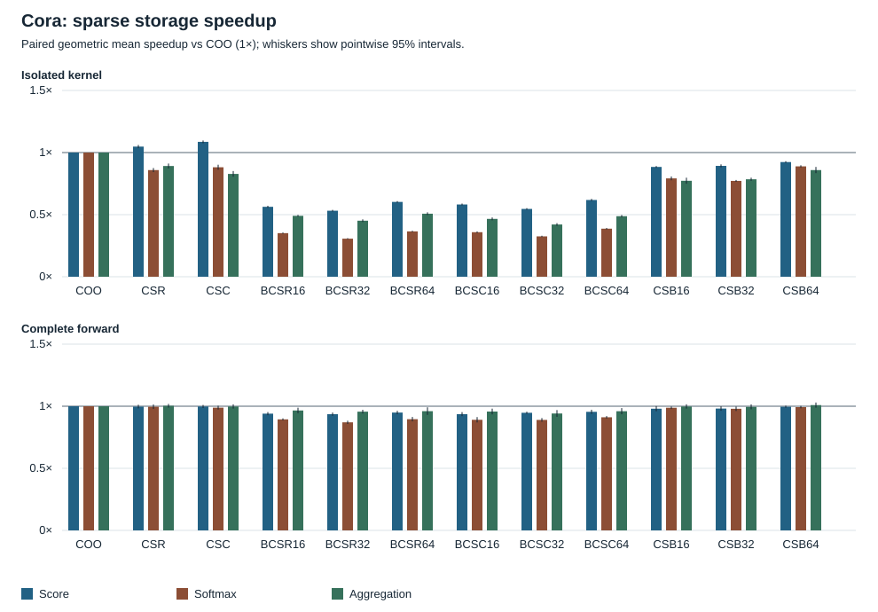
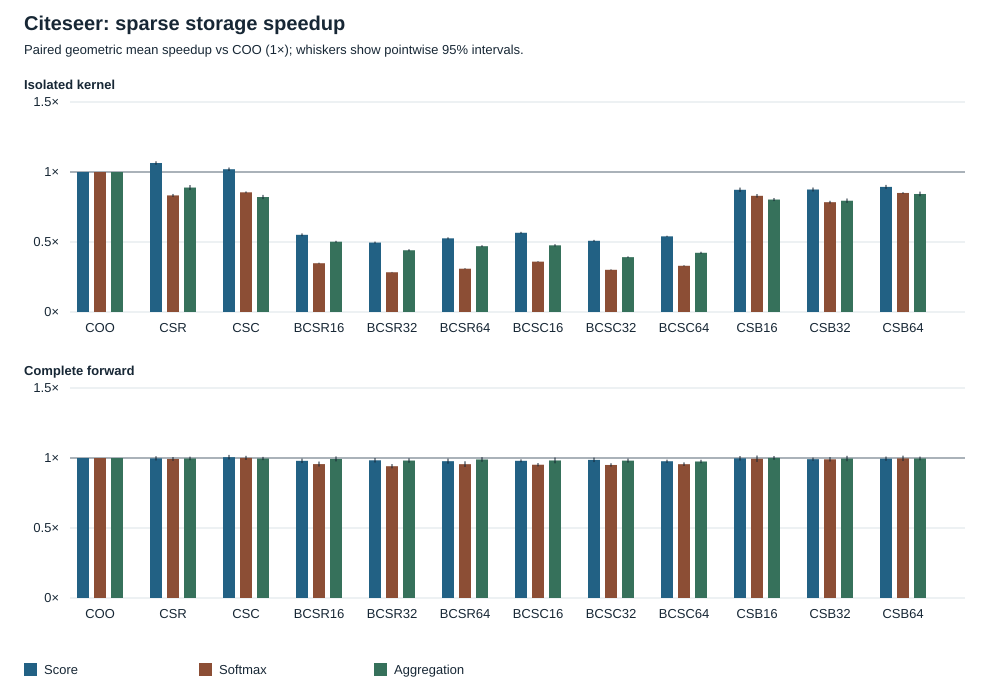
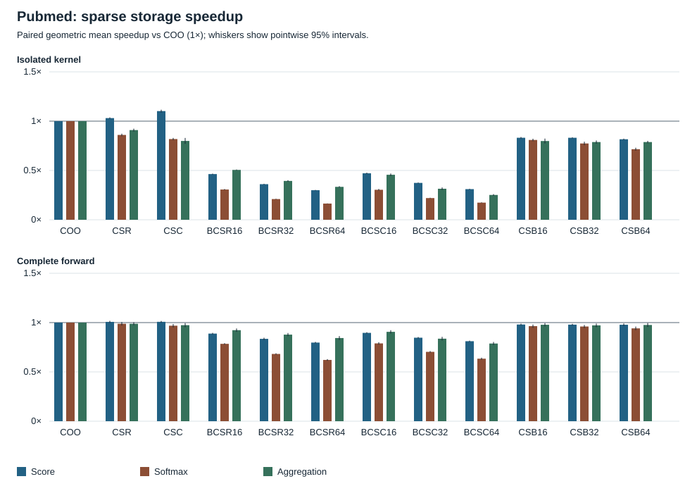

# Milestone 6: sparse storage and blocking for CPU GAT
All 108 dataset/kernel/format substitutions passed validation. The raw log contains 52,560 measured isolated-kernel and complete-forward observations, plus warmups and conversion samples.

## Fastest observed formats

Times are medians of process medians (ms). Speedup is the paired geometric mean vs the same-kernel COO case. A rank is descriptive; it does not establish superiority to every alternative.

| Dataset | Substituted kernel | Fastest isolated (ms; speedup) | Fastest full forward (ms; speedup) |
|---|---|---|---|
| cora | score | CSC (0.2179; 1.086×) | COO (3.7211; 1.000×) |
| cora | softmax | COO (0.1918; 1.000×) | COO (3.3805; 1.000×) |
| cora | aggregation | COO (0.1288; 1.000×) | CSC (3.3065; 0.998×) |
| citeseer | score | CSR (0.2116; 1.064×) | CSC (9.6709; 1.006×) |
| citeseer | softmax | COO (0.1821; 1.000×) | CSC (9.2496; 1.001×) |
| citeseer | aggregation | COO (0.1243; 1.000×) | CSC (9.2319; 0.996×) |
| pubmed | score | CSC (1.5777; 1.102×) | CSC (17.0052; 1.008×) |
| pubmed | softmax | COO (1.5611; 1.000×) | COO (14.3065; 1.000×) |
| pubmed | aggregation | COO (1.2193; 1.000×) | COO (13.6255; 1.000×) |

## All formats

Cells report isolated / forward latency in ms. See [paired contrasts](contrasts.csv) for CIs and Holm p-values against COO and ordinary CSR/CSC.

| Dataset | Format | Score | Softmax | Aggregation | Payload KiB | Build ms |
|---|---|---:|---:|---:|---:|---:|
| cora | COO | 0.2363 / 3.7211 | 0.1918 / 3.3805 | 0.1288 / 3.3299 | 103.6 | 0.0374 |
| cora | CSR | 0.2259 / 3.7450 | 0.2230 / 3.3903 | 0.1428 / 3.3143 | 114.2 | 0.1040 |
| cora | CSC | 0.2179 / 3.7341 | 0.2195 / 3.4071 | 0.1542 / 3.3065 | 114.2 | 0.4649 |
| cora | BCSR16 | 0.4174 / 3.9800 | 0.5434 / 3.7807 | 0.2611 / 3.4363 | 597.8 | 1.1694 |
| cora | BCSR32 | 0.4424 / 3.9498 | 0.6246 / 3.8708 | 0.2834 / 3.4618 | 728.8 | 1.1973 |
| cora | BCSR64 | 0.3929 / 3.9014 | 0.5243 / 3.7656 | 0.2523 / 3.4782 | 549.4 | 1.0538 |
| cora | BCSC16 | 0.4050 / 3.9529 | 0.5343 / 3.7727 | 0.2732 / 3.4630 | 597.8 | 1.0446 |
| cora | BCSC32 | 0.4300 / 3.9212 | 0.5893 / 3.8003 | 0.3044 / 3.5378 | 728.8 | 1.0841 |
| cora | BCSC64 | 0.3806 / 3.8749 | 0.4940 / 3.6898 | 0.2620 / 3.4154 | 549.4 | 1.0338 |
| cora | CSB16 | 0.2670 / 3.7903 | 0.2426 / 3.4228 | 0.1659 / 3.3434 | 242.5 | 1.0137 |
| cora | CSB32 | 0.2650 / 3.7872 | 0.2482 / 3.4875 | 0.1623 / 3.3499 | 212.2 | 0.9368 |
| cora | CSB64 | 0.2562 / 3.7346 | 0.2156 / 3.4155 | 0.1496 / 3.3072 | 176.0 | 0.8449 |
| citeseer | COO | 0.2253 / 9.7271 | 0.1821 / 9.2762 | 0.1243 / 9.2544 | 97.1 | 0.0367 |
| citeseer | CSR | 0.2116 / 9.6883 | 0.2183 / 9.3600 | 0.1386 / 9.2612 | 110.1 | 0.1072 |
| citeseer | CSC | 0.2202 / 9.6709 | 0.2133 / 9.2496 | 0.1514 / 9.2319 | 110.1 | 0.4198 |
| citeseer | BCSR16 | 0.4079 / 9.8798 | 0.5200 / 9.7303 | 0.2489 / 9.2881 | 602.9 | 1.2005 |
| citeseer | BCSR32 | 0.4532 / 9.8786 | 0.6409 / 9.8618 | 0.2825 / 9.4216 | 824.6 | 1.1462 |
| citeseer | BCSR64 | 0.4270 / 9.9053 | 0.5856 / 9.7575 | 0.2654 / 9.3247 | 734.1 | 1.0343 |
| citeseer | BCSC16 | 0.3970 / 9.9189 | 0.5027 / 9.7416 | 0.2625 / 9.4660 | 602.9 | 1.0154 |
| citeseer | BCSC32 | 0.4401 / 9.8497 | 0.6017 / 9.7517 | 0.3181 / 9.4509 | 824.6 | 1.0745 |
| citeseer | BCSC64 | 0.4153 / 9.9343 | 0.5490 / 9.6544 | 0.2947 / 9.4848 | 734.1 | 1.0218 |
| citeseer | CSB16 | 0.2581 / 9.7263 | 0.2201 / 9.3803 | 0.1562 / 9.3334 | 234.8 | 0.9980 |
| citeseer | CSB32 | 0.2571 / 9.7977 | 0.2329 / 9.3425 | 0.1577 / 9.2758 | 211.8 | 0.9174 |
| citeseer | CSB64 | 0.2514 / 9.7731 | 0.2144 / 9.3109 | 0.1479 / 9.2888 | 175.1 | 0.8431 |
| pubmed | COO | 1.7390 / 17.2060 | 1.5611 / 14.3065 | 1.2193 / 13.6255 | 846.6 | 0.2065 |
| pubmed | CSR | 1.6852 / 17.0849 | 1.8146 / 14.5145 | 1.3445 / 13.7497 | 923.6 | 0.6682 |
| pubmed | CSC | 1.5777 / 17.0052 | 1.9221 / 14.8495 | 1.5184 / 13.9405 | 923.6 | 4.9635 |
| pubmed | BCSR16 | 3.7565 / 19.3300 | 5.0754 / 18.1642 | 2.4017 / 14.7176 | 6507.8 | 12.9093 |
| pubmed | BCSR32 | 4.8117 / 20.6395 | 7.4671 / 20.9961 | 3.0681 / 15.4468 | 10682.4 | 17.9962 |
| pubmed | BCSR64 | 5.8189 / 21.5981 | 9.5637 / 23.0426 | 3.6356 / 16.0924 | 14740.3 | 16.2687 |
| pubmed | BCSC16 | 3.6535 / 19.2227 | 5.1400 / 18.2174 | 2.6449 / 15.0754 | 6507.8 | 11.8474 |
| pubmed | BCSC32 | 4.6670 / 20.2862 | 7.1187 / 20.3505 | 3.8507 / 16.1739 | 10682.4 | 15.6121 |
| pubmed | BCSC64 | 5.5865 / 21.1902 | 9.0219 / 22.5618 | 4.8413 / 17.2633 | 14740.3 | 15.3968 |
| pubmed | CSB16 | 2.0948 / 17.4847 | 1.9325 / 14.8991 | 1.5088 / 13.8924 | 2268.1 | 10.4019 |
| pubmed | CSB32 | 2.0897 / 17.5882 | 2.0147 / 14.9430 | 1.5529 / 14.0400 | 2163.8 | 9.9742 |
| pubmed | CSB64 | 2.1364 / 17.5720 | 2.1774 / 15.2352 | 1.5391 / 13.9341 | 1911.1 | 9.4719 |

Stock DGL GATConv reference times (ms): cora 3.8221, citeseer 9.7214, pubmed 16.2985.
The stock reference is a different execution stack, not the COO denominator.

## Speedup plots

## Blocking and tuning implications

Keep the format axis stage-specific. A fast isolated traversal does not by itself justify a full-forward choice. Use the paired forward contrasts and construction/storage costs before promoting a block size.

| Endpoint | Format family | Holm-supported gains vs COO | Holm-supported losses vs COO |
|---|---|---:|---:|
| kernel | CSR | 3/9 | 6/9 |
| kernel | CSC | 2/9 | 6/9 |
| kernel | BCSR | 0/27 | 27/27 |
| kernel | BCSC | 0/27 | 27/27 |
| kernel | CSB | 0/27 | 27/27 |
| forward | CSR | 0/9 | 0/9 |
| forward | CSC | 0/9 | 0/9 |
| forward | BCSR | 0/27 | 17/27 |
| forward | BCSC | 0/27 | 17/27 |
| forward | CSB | 0/27 | 1/27 |

### Blocked vs ordinary parent format

Counts span the three datasets, three kernels and three block sizes per family.

| Endpoint | Comparison | Supported gains | Supported losses |
|---|---|---:|---:|
| kernel | BCSR vs CSR | 0/27 | 27/27 |
| kernel | BCSC vs CSC | 0/27 | 27/27 |
| forward | BCSR vs CSR | 0/27 | 17/27 |
| forward | BCSC vs CSC | 0/27 | 19/27 |

### Best observed blocked layout and its cost

These are descriptive ranks. The paired interval compares each layout with COO, not with other block sizes.

| Dataset | Kernel | Best blocked | Kernel ms | Speedup vs COO (95% CI) |
|---|---|---|---:|---|
| cora | score | CSB64 | 0.2562 | 0.923 [0.917, 0.930] |
| cora | softmax | CSB64 | 0.2156 | 0.889 [0.880, 0.897] |
| cora | aggregation | CSB64 | 0.1496 | 0.859 [0.834, 0.884] |
| citeseer | score | CSB64 | 0.2514 | 0.894 [0.880, 0.908] |
| citeseer | softmax | CSB64 | 0.2144 | 0.850 [0.845, 0.856] |
| citeseer | aggregation | CSB64 | 0.1479 | 0.843 [0.826, 0.860] |
| pubmed | score | CSB32 | 2.0897 | 0.831 [0.827, 0.836] |
| pubmed | softmax | CSB16 | 1.9325 | 0.809 [0.797, 0.821] |
| pubmed | aggregation | CSB16 | 1.5088 | 0.798 [0.774, 0.823] |

| Dataset | Blocked CSR/CSC payload vs COO | CSB payload vs COO |
|---|---:|---:|
| cora | 5.30–7.03× | 1.70–2.34× |
| citeseer | 6.21–8.49× | 1.80–2.42× |
| pubmed | 7.69–17.41× | 2.26–2.68× |

### Candidates for future tuning

No format produced a Holm-supported full-forward gain vs COO in this run. Retain conventional controls; treat any observed winner or block-size ranking as exploratory.

A supported difference from COO does not establish a difference between two block sizes. The experiment does not time combinations of substitutions.

Supported isolated gains vs COO: cora/score/CSR (1.048×); cora/score/CSC (1.086×); citeseer/score/CSR (1.064×); pubmed/score/CSR (1.031×); pubmed/score/CSC (1.102×). These justify retaining conventional formats as kernel-level candidates, but the forward evidence does not justify promoting a blocked default.

## Measurement and correctness

CPU: AMD Ryzen 7 7800X3D 8-Core Processor, pinned logical CPU 0. DGL 1.1.3, Torch 2.2.2+cpu, four heads, eight channels/head, FP32, eval/inference mode. Graph EIDs, feature bytes and seed-0 parameter bytes match Milestone 5. The prior policy removes all self-loops and appends exactly one per node. No reordering or coalescing.

8 fresh serial process rounds per dataset; 10 warmup and 30 measured randomized matched blocks per endpoint per process. Pointwise Student-t intervals use paired log ratios of round medians, not individual repetitions. Holm adjustment is separate by endpoint across 270 contrasts against COO, CSR, and CSC. No sample exclusions.

Only the selected sparse operation changes. Score timing includes LeakyReLU but not node-term construction. All formats use canonical EID outputs and the same arithmetic. Softmax uses three full traversals and FP32 destination max/sum scratch. All scratch/output allocations are timed. Graph construction and conversion are outside forward timing; no runtime format conversion is needed.

Build time is the median of round medians for five independently randomized builds from canonical COO arrays. Payload bytes count sparse index arrays only, not allocator overhead, original graph, dense features or softmax scratch. Blocked CSR/CSC pay for local pointer rows even when a nonempty tile is very sparse; CSB pays for both local coordinates per edge. Neither format pays for dense padding or empty tiles.

Maximum absolute error: final output 1.49e-08; isolated intermediate 4.47e-08; destination softmax sum 4.72e-07. Full output and attention reference are checked against untouched stock GATConv.

One host and one kernel implementation family: no claim that a storage format is universally faster, or that these rankings transfer to a destination-specialized softmax, multiple threads, or trained models.

Raw samples, environment, hashes and execution order: [RESULTS.json](RESULTS.json). Machine-readable summaries: [timings.csv](timings.csv), [storage.csv](storage.csv), [contrasts.csv](contrasts.csv).
