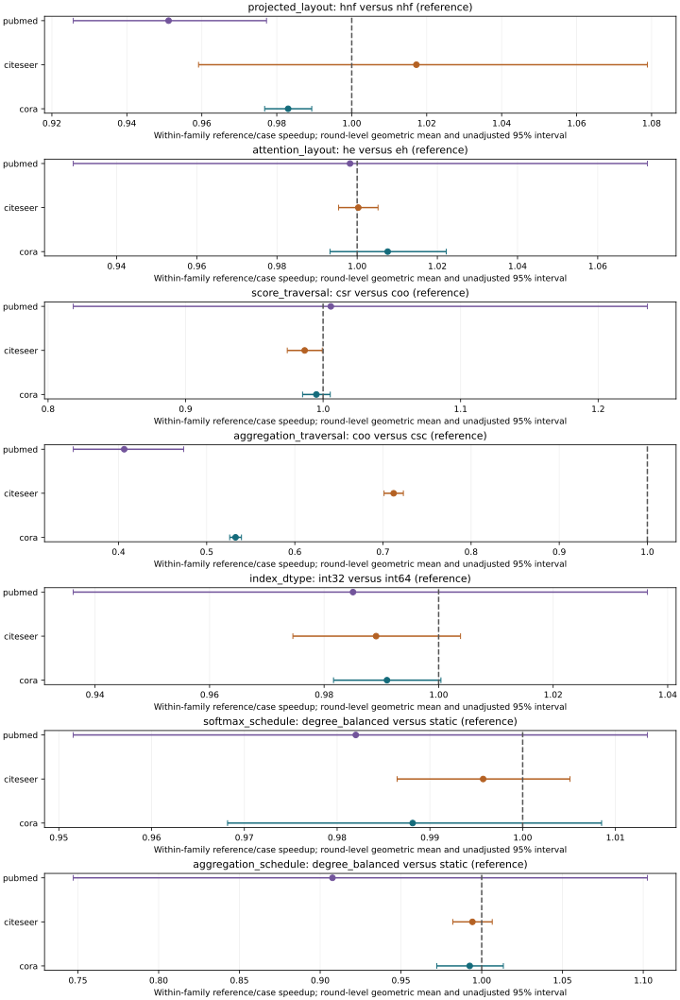

# Milestone 5 — Independent DGL GAT CPU tuning axes

## 1. Research objective and scope

Evaluate four families independently: graph index dtype, stage-specific sparse traversal, physical intermediate layouts and sparse scheduling. There is no joint/factorial search, network architecture change, predictive cost tensor or model fit. All cases retain native dataset features/topology, four heads, eight output features per head, float32, identical weights, no dropout, no residual/activation and output bias enabled. The complete untouched DGL 1.1.3 GATConv is the oracle and an independently timed performance reference.

The seven contrasts below are one-parameter experiments. A slower custom family can still expose a useful internal trade-off; its gap from official DGL is shown separately and must not be attributed entirely to the named parameter.

## 2. Environment and reproducibility

| Field | Recorded value |
| --- | --- |
| cpu_model | INTEL(R) XEON(R) PLATINUM 8573C |
| logical_cpus | 5 |
| cpu_affinity | [0, 1, 2, 3, 4] |
| os | Linux-6.18.57-x86_64-with-glibc2.41 |
| python | 3.11.17 |
| dgl | 1.1.3 |
| torch | 2.2.2+cpu |
| torch_threads | 1 |
| torch_interop_threads | 1 |
| thread_environment | {'OMP_NUM_THREADS': '1', 'OMP_DYNAMIC': None, 'OMP_PROC_BIND': None, 'OMP_PLACES': None, 'MKL_NUM_THREADS': '1', 'OPENBLAS_NUM_THREADS': '1'} |
| runtime_thread_controls | {'OMP_WAIT_POLICY': 'PASSIVE', 'KMP_BLOCKTIME': '0'} |
| loaded_openmp_libraries | ['/workspace/dgl-performance-model/.venv/lib/python3.11/site-packages/torch/lib/libgomp-a34b3233.so.1'] |
| git_commit | ede88f3acafc02761b4325bb387082ea1695ad20 |
| cpu_quota | 400000 100000 |
| lock_sha256 | 0003b42e4bde11c9e2da48fadb04f8e6288fb689b9e6ed10b20198fb85e19992 |

| Dataset | Nodes | Edges incl. self-loops | Native input width | Mean incoming degree | Max incoming degree |
| --- | --- | --- | --- | --- | --- |
| cora | 2708 | 13264 | 1433 | 4.898 | 169 |
| citeseer | 3327 | 12431 | 3703 | 3.736 | 100 |
| pubmed | 19717 | 108365 | 500 | 5.496 | 172 |

One-thread groups contain A/B/C; four-thread groups contain the two D scheduling contrasts. Each axis has 6 independent fresh-process rounds per dataset. Groups share a process only within a round; each parameter still has distinct processes across its rounds. No two measurement processes run concurrently. Both schedule values use exactly four PyTorch/OpenMP/MKL threads, inter-op one; the actual compiled OpenMP team is checked. Threads are an external fixed control, not a hidden tuning factor. OMP_WAIT_POLICY=PASSIVE and KMP_BLOCKTIME=0 are fixed before runtime import to avoid idle-team spinning; the loaded OpenMP libraries are recorded.

Each block uses 5 warmups and 20 timed forward repetitions. Case order and axis order are randomized from recorded seeds. Before and after each candidate, the same within-family reference is measured; reference/case speedup uses the mean of these bracketing median times. Each axis also has official-DGL blocks before and after its case groups. A reference row is normalized to one by definition, not a claim of zero timing noise.

Ordinary full-forward passes have no internal clock reads, profiler callbacks or stage dictionaries. Separate instrumented passes collect logical-stage timing; do not sum these to predict uninstrumented latency. Per-thread service clocks are enabled only for separate diagnostic calls. Per-round process peak RSS spans loading, validation and all axes in that process; it is not per-case peak memory.

The compiler is g++ (Debian 14.2.0-19) 14.2.0. Flags: `-std=c++17 -O3 -fPIC -shared -fopenmp -ffp-contract=off`. No fast-math or accelerator build is used. The OpenMP C ABI library is loaded via stdlib ctypes, with no Torch extension headers or new Python runtime dependencies. Compilation and its cache status are recorded separately; binary objects live only in ignored results paths. New source hashes, compiler/binary digests and the historical base commit are retained.

## 3. Exact implementations and fixed references

**index_dtype** — Official g.long()/g.int(), all formats materialized, original orders, one thread; complete official GATConv. Check counts, row pointers, EIDs, actual index min/max and flattened EH/ND/NHF bounds before narrowing. Topology and data associations are verified through every materialized representation.

**score_traversal** — One DGL-primitive orchestrator uses gsddmm(add,l,r) on a sole COO or sole CSR view. Softmax and aggregation both stay CSC; original EIDs, NHF, threads and score arithmetic are unchanged. The degree guard executes on the canonical graph, not the CSR-only score view.

**aggregation_traversal** — Same orchestrator, COO score route and CSC destination softmax, varying only gspmm(mul,sum) on sole CSC or sole COO. The generic CPU routes differ in destination ownership versus edge-oriented atomic accumulation. Both are measured at ONE thread here; this is not a parallel thread-count comparison.

**projected_layout** — One common compiled family consumes logical [N,H,F] in NHF or physical contiguous [H,N,F]. The shared Torch projection initially produces NHF; HNF packing occurs each forward and is included. Native node-contribution and aggregation address functions read HNF directly, without conversion back to NHF. All loop organizations, edge layout and schedules are fixed.

**attention_layout** — Same compiled family, fixed NHF features and static row ownership, scores/attention physically [E,H] or contiguous [H,E]. Producers and all consumers use the corresponding eoff address function; no repack to EH occurs. Add and LeakyReLU remain separate passes. This is not an EID permutation or a transpose label erased by DGL.

**softmax_schedule** — Common compiled family at FOUR threads: contiguous destination-row ownership versus deterministic largest-degree-first greedy ownership, weighted by degree+1, with node-ID ties and sorted rows inside each thread. Whole rows remain intact; per-row head/neighbor math order is identical. Aggregation ownership stays static.

**aggregation_schedule** — Same four-thread family, only destination-row-to-thread ownership changes. Softmax ownership stays static. There are no atomics, row splits or merging partial outputs; each complete destination row has exactly one owner.

The custom family is not asserted identical in overhead to stock DGL: it computes the two node contributions in one compiled node loop, uses output scratch for a three-pass stable softmax, and calls through ctypes. These choices stay fixed within layout/scheduling contrasts. Comparing a custom case directly to stock does not isolate layout or scheduling. Output bias is a separate Torch addition. No source/destination projected-feature dot product replaces additive GAT attention.

### Backend-route evidence

Every stage-specific DGL view records exactly one allowed/materialized representation. A successful gsddmm on a sole CSR view cannot silently use COO; a successful sole-COO gspmm cannot silently use CSC. The audited v1.1.3 dispatcher switches CSR/COO for generalized SDDMM and CSC/COO for generalized SpMM; CPU edge softmax receives CSC. Thus runtime view restrictions plus successful primitives and source dispatch identify different routes. No dynamic C++ symbol trace is claimed. Graph states are checked again after timing. Internal optimized-versus-generic subkernel selection is not established by these records.

The v1.1.3 CPU source has an edge-parallel COO score loop and a source-row CSR score loop. COO sum aggregation loops over edges with atomic updates; CSC is passed to the incoming-row CSR interface. See SOURCES.json for the independently retrieved, hash-verified source URLs and exact dispatch evidence. This is also the D1 edge-processing scheduling comparison; it is not added a second time as a nominal schedule axis.

This does not make a sole-format complete stock layer valid: COO-only still lacks CSC softmax, CSR-only cannot execute the stock incoming-degree guard, and CSC-only cannot execute score SDDMM. The preserved historical pilot and regression checks retain these failures. The new orchestration calls each primitive on a compatible view and leaves the degree check on the canonical graph; it does not silently broaden any stage mask.

### Physical addresses and copies

NHF strides are (H*F,F,1); HNF physical strides are contiguous [H,N,F], exposing logical [N,H,F] strides (F,N*F,1). EH logical strides are (H,1); HE storage exposes logical [E,H] strides (1,E). Tensor metadata records both physical and logical shapes/strides. Default NHF packing is an identity. HNF packing reads/writes Z each forward; HE scores/attention are produced directly in that storage. All real-data output nodes/EIDs remain canonical, so no per-forward node restoration or edge remapping is required.

## 4. Numerical validation

The complete layer and accessible intermediates are checked at rtol=1e-4, atol=1e-5. Reference intermediate calculations use the official layer parameters and matching DGL primitives, and attention/final output are cross-checked with untouched GATConv(get_attention=True). We compare Z, node l/r, raw additive logits, LeakyReLU logits, normalized attention, aggregated values and final output wherever exposed. Index dtype uses the untouched complete layer and exposes output/attention rather than inventing its logical-stage profile. Repeated forwards must be bitwise repeatable within the tested process/configuration. All real inputs are finite. Tests additionally cover zero/tiny/scaled finite features, high-degree destinations, parallel edges, self-loops, initially isolated nodes, nondivisible sizes, nonzero bias and nontrivial restored node/EID mappings. Zero-in-degree guards remain enabled. Stable softmax subtracts the full destination/head maximum and normalizes the full neighborhood, never independent chunks.

| Dataset | Axis | Value | Status | Max output abs error | Max scaled intermediate error | Repeatable |
| --- | --- | --- | --- | --- | --- | --- |
| cora | projected_layout | nhf | measured | 0.0 | 0.0 | True |
| cora | projected_layout | hnf | measured | 0.0 | 0.0 | True |
| cora | attention_layout | eh | measured | 0.0 | 0.0 | True |
| cora | attention_layout | he | measured | 0.0 | 0.0 | True |
| cora | score_traversal | coo | measured | 0.0 | 0.0 | True |
| cora | score_traversal | csr | measured | 0.0 | 0.0 | True |
| cora | aggregation_traversal | csc | measured | 0.0 | 0.0 | True |
| cora | aggregation_traversal | coo | measured | 0.0 | 0.0 | True |
| cora | index_dtype | int64 | measured | 0.0 | 0.0 | True |
| cora | index_dtype | int32 | measured | 0.0 | 0.0 | True |
| cora | softmax_schedule | static | measured | 0.0 | 0.0 | True |
| cora | softmax_schedule | degree_balanced | measured | 0.0 | 0.0 | True |
| cora | aggregation_schedule | static | measured | 0.0 | 0.0 | True |
| cora | aggregation_schedule | degree_balanced | measured | 0.0 | 0.0 | True |
| citeseer | aggregation_traversal | csc | measured | 0.0 | 0.0 | True |
| citeseer | aggregation_traversal | coo | measured | 0.0 | 0.0 | True |
| citeseer | projected_layout | nhf | measured | 0.0 | 0.0 | True |
| citeseer | projected_layout | hnf | measured | 0.0 | 0.0 | True |
| citeseer | score_traversal | coo | measured | 0.0 | 0.0 | True |
| citeseer | score_traversal | csr | measured | 0.0 | 0.0 | True |
| citeseer | index_dtype | int64 | measured | 0.0 | 0.0 | True |
| citeseer | index_dtype | int32 | measured | 0.0 | 0.0 | True |
| citeseer | attention_layout | eh | measured | 0.0 | 0.0 | True |
| citeseer | attention_layout | he | measured | 0.0 | 0.0 | True |
| citeseer | aggregation_schedule | static | measured | 0.0 | 0.0 | True |
| citeseer | aggregation_schedule | degree_balanced | measured | 0.0 | 0.0 | True |
| citeseer | softmax_schedule | static | measured | 0.0 | 0.0 | True |
| citeseer | softmax_schedule | degree_balanced | measured | 0.0 | 0.0 | True |
| pubmed | index_dtype | int64 | measured | 0.0 | 0.0 | True |
| pubmed | index_dtype | int32 | measured | 0.0 | 0.0 | True |
| pubmed | attention_layout | eh | measured | 0.0 | 0.0 | True |
| pubmed | attention_layout | he | measured | 0.0 | 0.0 | True |
| pubmed | aggregation_traversal | csc | measured | 0.0 | 0.0 | True |
| pubmed | aggregation_traversal | coo | measured | 0.0 | 0.0 | True |
| pubmed | score_traversal | coo | measured | 0.0 | 0.0 | True |
| pubmed | score_traversal | csr | measured | 0.0 | 0.0 | True |
| pubmed | projected_layout | nhf | measured | 0.0 | 0.0 | True |
| pubmed | projected_layout | hnf | measured | 0.0 | 0.0 | True |
| pubmed | softmax_schedule | static | measured | 0.0 | 0.0 | True |
| pubmed | softmax_schedule | degree_balanced | measured | 0.0 | 0.0 | True |
| pubmed | aggregation_schedule | static | measured | 0.0 | 0.0 | True |
| pubmed | aggregation_schedule | degree_balanced | measured | 0.0 | 0.0 | True |

## 5. Sparse index dtype

**Recommendation B** — Real implementations, but effects are small or process-round intervals are inconclusive

| Dataset | Value | Median of round medians ms | Mean round mean ms | Between-round SD ms | Within-family speedup [95% CI] | Official/case speedup [95% CI] |
| --- | --- | --- | --- | --- | --- | --- |
| cora | int64 | 3.94275 | 3.98162 | 0.05926 | 1.000 [1.000, 1.000] | 1.012 [0.979, 1.047] |
| cora | int32 | 3.98607 | 4.09473 | 0.04697 | 0.991 [0.982, 1.000] | 1.000 [0.979, 1.023] |
| citeseer | int64 | 8.01083 | 8.13227 | 0.10905 | 1.000 [1.000, 1.000] | 0.995 [0.981, 1.010] |
| citeseer | int32 | 8.00450 | 8.12090 | 0.12895 | 0.989 [0.975, 1.004] | 0.994 [0.979, 1.011] |
| pubmed | int64 | 18.66505 | 20.47283 | 3.72362 | 1.000 [1.000, 1.000] | 0.961 [0.878, 1.051] |
| pubmed | int32 | 19.36134 | 21.80386 | 1.70619 | 0.985 [0.936, 1.036] | 0.980 [0.888, 1.081] |

Speedup above one favors the candidate; official/case below one means the custom/primitive family is slower than official DGL. Intervals are t intervals of independent-round log ratios, unadjusted for multiple comparisons. Rankings use within-family normalized times, not absolute latencies of unrelated families.

Best observed within-family values: **{'cora': 'int64', 'citeseer': 'int64', 'pubmed': 'int64'}**. Credible preference directions: **{'cora': 'inconclusive', 'citeseer': 'inconclusive', 'pubmed': 'inconclusive'}**. A changed point-estimate winner is not automatically a statistically credible crossover.

| Dataset | Value | Actual dtype | Unique sparse tensor payload bytes | Cast+materialization ms |
| --- | --- | --- | --- | --- |
| cora | int64 | torch.int64 | 680016 | 0.0208 |
| cora | int32 | torch.int32 | 340008 | 0.1188 |
| citeseer | int64 | torch.int64 | 649936 | 0.0268 |
| citeseer | int32 | torch.int32 | 324968 | 0.1645 |
| pubmed | int64 | torch.int64 | 5517008 | 0.0366 |
| pubmed | int32 | torch.int32 | 2758504 | 0.5553 |

Payload deduplicates exposed index-array storages inside one graph; features, hidden graph metadata, allocator overhead, other resident views and whole-process peak are not included. A smaller payload does not establish faster execution or that Reddit fits. If one width dominates across this envelope, use it as a legality-checked default here, not a universal rule for larger graphs or other CPUs.

## 6. COO versus CSR additive score traversal

**Recommendation B** — Real implementations, but effects are small or process-round intervals are inconclusive

| Dataset | Value | Median of round medians ms | Mean round mean ms | Between-round SD ms | Within-family speedup [95% CI] | Official/case speedup [95% CI] |
| --- | --- | --- | --- | --- | --- | --- |
| cora | coo | 3.64325 | 3.69945 | 0.08859 | 1.000 [1.000, 1.000] | 1.086 [1.073, 1.098] |
| cora | csr | 3.70587 | 3.75776 | 0.03056 | 0.995 [0.985, 1.005] | 1.075 [1.057, 1.093] |
| citeseer | coo | 7.76035 | 7.78209 | 0.12539 | 1.000 [1.000, 1.000] | 1.042 [1.021, 1.063] |
| citeseer | csr | 7.78791 | 7.86241 | 0.14482 | 0.987 [0.974, 0.999] | 1.029 [1.009, 1.049] |
| pubmed | coo | 18.32730 | 20.64406 | 2.16752 | 1.000 [1.000, 1.000] | 1.161 [0.916, 1.471] |
| pubmed | csr | 18.85383 | 23.76701 | 6.15717 | 1.006 [0.818, 1.236] | 1.036 [0.830, 1.292] |

Speedup above one favors the candidate; official/case below one means the custom/primitive family is slower than official DGL. Intervals are t intervals of independent-round log ratios, unadjusted for multiple comparisons. Rankings use within-family normalized times, not absolute latencies of unrelated families.

Best observed within-family values: **{'cora': 'coo', 'citeseer': 'coo', 'pubmed': 'csr'}**. Credible preference directions: **{'cora': 'inconclusive', 'citeseer': 'reference', 'pubmed': 'inconclusive'}**. A changed point-estimate winner is not automatically a statistically credible crossover.

## 7. CSC versus COO weighted aggregation

**Recommendation E** — Same option credibly dominates by at least 3% on all three tested workloads; collapse only within this envelope

| Dataset | Value | Median of round medians ms | Mean round mean ms | Between-round SD ms | Within-family speedup [95% CI] | Official/case speedup [95% CI] |
| --- | --- | --- | --- | --- | --- | --- |
| cora | csc | 3.72973 | 3.75406 | 0.04819 | 1.000 [1.000, 1.000] | 1.094 [1.020, 1.173] |
| cora | coo | 6.98016 | 7.14685 | 0.06987 | 0.533 [0.526, 0.539] | 0.584 [0.545, 0.625] |
| citeseer | csc | 7.81883 | 7.92414 | 0.08663 | 1.000 [1.000, 1.000] | 1.029 [1.010, 1.047] |
| citeseer | coo | 10.85404 | 11.00810 | 0.21571 | 0.712 [0.701, 0.723] | 0.739 [0.722, 0.756] |
| pubmed | csc | 18.34178 | 19.68160 | 1.93448 | 1.000 [1.000, 1.000] | 1.004 [0.965, 1.046] |
| pubmed | coo | 43.61524 | 49.43815 | 10.51796 | 0.406 [0.349, 0.474] | 0.402 [0.333, 0.484] |

Speedup above one favors the candidate; official/case below one means the custom/primitive family is slower than official DGL. Intervals are t intervals of independent-round log ratios, unadjusted for multiple comparisons. Rankings use within-family normalized times, not absolute latencies of unrelated families.

Best observed within-family values: **{'cora': 'csc', 'citeseer': 'csc', 'pubmed': 'csc'}**. Credible preference directions: **{'cora': 'reference', 'citeseer': 'reference', 'pubmed': 'reference'}**. A changed point-estimate winner is not automatically a statistically credible crossover.

## 8. Physical projected-feature NHF versus HNF

**Recommendation D** — Useful measured effect, but conditional on this implementation/resource/workload family; no demonstrated reversal

| Dataset | Value | Median of round medians ms | Mean round mean ms | Between-round SD ms | Within-family speedup [95% CI] | Official/case speedup [95% CI] |
| --- | --- | --- | --- | --- | --- | --- |
| cora | nhf | 3.15419 | 3.16786 | 0.05517 | 1.000 [1.000, 1.000] | 1.267 [1.237, 1.297] |
| cora | hnf | 3.17979 | 3.22058 | 0.04761 | 0.983 [0.977, 0.989] | 1.248 [1.221, 1.275] |
| citeseer | nhf | 7.11342 | 7.38972 | 0.06891 | 1.000 [1.000, 1.000] | 1.130 [1.119, 1.142] |
| citeseer | hnf | 7.23565 | 7.31002 | 0.06376 | 1.017 [0.959, 1.079] | 1.117 [1.103, 1.132] |
| pubmed | nhf | 14.72148 | 14.96590 | 0.44247 | 1.000 [1.000, 1.000] | 1.337 [1.251, 1.429] |
| pubmed | hnf | 15.66752 | 16.64042 | 0.34486 | 0.951 [0.926, 0.977] | 1.257 [1.172, 1.347] |

Speedup above one favors the candidate; official/case below one means the custom/primitive family is slower than official DGL. Intervals are t intervals of independent-round log ratios, unadjusted for multiple comparisons. Rankings use within-family normalized times, not absolute latencies of unrelated families.

Best observed within-family values: **{'cora': 'nhf', 'citeseer': 'hnf', 'pubmed': 'nhf'}**. Credible preference directions: **{'cora': 'reference', 'citeseer': 'inconclusive', 'pubmed': 'reference'}**. A changed point-estimate winner is not automatically a statistically credible crossover.

| Dataset | Value | Logical shape | Actual logical strides | Physical shape | Profiled packing ms | Detailed live intermediate payload bytes |
| --- | --- | --- | --- | --- | --- | --- |
| cora | nhf | [2708, 4, 8] | [32, 8, 1] | [2708, 4, 8] | 0.0008046666666666666 | 1763200 |
| cora | hnf | [2708, 4, 8] | [8, 21664, 1] | [4, 2708, 8] | 0.07076891666666667 | 1763200 |
| citeseer | nhf | [3327, 4, 8] | [32, 8, 1] | [3327, 4, 8] | 0.0007749166666666667 | 1980720 |
| citeseer | hnf | [3327, 4, 8] | [8, 26616, 1] | [4, 3327, 8] | 0.0825895 | 1980720 |
| pubmed | nhf | [19717, 4, 8] | [32, 8, 1] | [19717, 4, 8] | 0.000883 | 13403792 |
| pubmed | hnf | [19717, 4, 8] | [8, 157736, 1] | [4, 19717, 8] | 0.6129200833333334 | 13403792 |

The memory column is live exposed tensor payload in detailed validation, not allocator peak. HNF packing temporarily overlaps the original projection buffer, so its packing peak can exceed the end-of-validation payload. Profiled packing includes stage-call timing overhead; the identity path performs no copy.

## 9. Physical score/attention EH versus HE

**Recommendation B** — Real implementations, but effects are small or process-round intervals are inconclusive

| Dataset | Value | Median of round medians ms | Mean round mean ms | Between-round SD ms | Within-family speedup [95% CI] | Official/case speedup [95% CI] |
| --- | --- | --- | --- | --- | --- | --- |
| cora | eh | 3.15122 | 3.18911 | 0.04350 | 1.000 [1.000, 1.000] | 1.274 [1.250, 1.299] |
| cora | he | 3.10730 | 3.18357 | 0.05887 | 1.008 [0.993, 1.022] | 1.283 [1.246, 1.321] |
| citeseer | eh | 7.07287 | 7.19727 | 0.06558 | 1.000 [1.000, 1.000] | 1.122 [1.112, 1.133] |
| citeseer | he | 7.07875 | 7.15915 | 0.02644 | 1.000 [0.995, 1.005] | 1.126 [1.116, 1.135] |
| pubmed | eh | 14.61233 | 15.87080 | 1.86893 | 1.000 [1.000, 1.000] | 1.275 [1.196, 1.360] |
| pubmed | he | 15.73421 | 16.89529 | 0.93859 | 0.998 [0.929, 1.072] | 1.212 [1.187, 1.236] |

Speedup above one favors the candidate; official/case below one means the custom/primitive family is slower than official DGL. Intervals are t intervals of independent-round log ratios, unadjusted for multiple comparisons. Rankings use within-family normalized times, not absolute latencies of unrelated families.

Best observed within-family values: **{'cora': 'he', 'citeseer': 'he', 'pubmed': 'eh'}**. Credible preference directions: **{'cora': 'inconclusive', 'citeseer': 'inconclusive', 'pubmed': 'inconclusive'}**. A changed point-estimate winner is not automatically a statistically credible crossover.

| Dataset | Value | Logical shape | Actual logical strides | Physical shape | Profiled packing ms | Detailed live intermediate payload bytes |
| --- | --- | --- | --- | --- | --- | --- |
| cora | eh | [13264, 4, 1] | [4, 1, 1] | [13264, 4] | 0 | 1763200 |
| cora | he | [13264, 4, 1] | [1, 13264, 1] | [4, 13264] | 0 | 1763200 |
| citeseer | eh | [12431, 4, 1] | [4, 1, 1] | [12431, 4] | 0 | 1980720 |
| citeseer | he | [12431, 4, 1] | [1, 12431, 1] | [4, 12431] | 0 | 1980720 |
| pubmed | eh | [108365, 4, 1] | [4, 1, 1] | [108365, 4] | 0 | 13403792 |
| pubmed | he | [108365, 4, 1] | [1, 108365, 1] | [4, 108365] | 0 | 13403792 |

The memory column is live exposed tensor payload in detailed validation, not allocator peak. HNF packing temporarily overlaps the original projection buffer, so its packing peak can exceed the end-of-validation payload. Profiled packing includes stage-call timing overhead; the identity path performs no copy.

## 10. Four-thread softmax row scheduling

**Recommendation B** — Real implementations, but effects are small or process-round intervals are inconclusive

| Dataset | Value | Median of round medians ms | Mean round mean ms | Between-round SD ms | Within-family speedup [95% CI] | Official/case speedup [95% CI] |
| --- | --- | --- | --- | --- | --- | --- |
| cora | static | 2.29415 | 2.33196 | 0.10544 | 1.000 [1.000, 1.000] | 1.438 [1.411, 1.465] |
| cora | degree_balanced | 2.29879 | 2.44812 | 0.09392 | 0.988 [0.968, 1.009] | 1.434 [1.397, 1.472] |
| citeseer | static | 4.21300 | 4.23880 | 0.09744 | 1.000 [1.000, 1.000] | 1.271 [1.256, 1.287] |
| citeseer | degree_balanced | 4.23204 | 4.25493 | 0.09737 | 0.996 [0.986, 1.005] | 1.265 [1.247, 1.283] |
| pubmed | static | 8.07878 | 8.44988 | 0.31789 | 1.000 [1.000, 1.000] | 1.340 [1.290, 1.391] |
| pubmed | degree_balanced | 8.36268 | 8.72330 | 0.37363 | 0.982 [0.952, 1.013] | 1.314 [1.281, 1.348] |

Speedup above one favors the candidate; official/case below one means the custom/primitive family is slower than official DGL. Intervals are t intervals of independent-round log ratios, unadjusted for multiple comparisons. Rankings use within-family normalized times, not absolute latencies of unrelated families.

Best observed within-family values: **{'cora': 'static', 'citeseer': 'static', 'pubmed': 'static'}**. Credible preference directions: **{'cora': 'inconclusive', 'citeseer': 'inconclusive', 'pubmed': 'inconclusive'}**. A changed point-estimate winner is not automatically a statistically credible crossover.

| Dataset | Schedule | Rows per thread | Edges per thread | Partition preparation ms | Actual threads |
| --- | --- | --- | --- | --- | --- |
| cora | static | [677, 677, 677, 677] | [3397, 3206, 3792, 2869] | 0.3008 | 4 |
| cora | degree_balanced | [675, 677, 678, 678] | [3317, 3315, 3316, 3316] | 8.5003 | 4 |
| citeseer | static | [831, 832, 832, 832] | [3146, 3154, 3176, 2955] | 0.2784 | 4 |
| citeseer | degree_balanced | [831, 832, 832, 832] | [3110, 3107, 3107, 3107] | 10.4548 | 4 |
| pubmed | static | [4929, 4929, 4929, 4930] | [27678, 26850, 27337, 26500] | 1.0525 | 4 |
| pubmed | degree_balanced | [4929, 4929, 4929, 4930] | [27091, 27091, 27091, 27092] | 64.9425 | 4 |

Greedy assignment balances a degree+1 work proxy, not measured cycles. Row migration can hurt locality; a single heavy row is unsplittable in both alternatives. Per-thread service times in RESULTS.json are separate single diagnostic calls per round, exclude the final team barrier and are not standalone performance-confidence estimates. Each stage has one implicit team-completion barrier. Softmax uses thread-local max/sum scalars and alpha as exponent scratch; aggregation has no private full-output buffers or cross-thread reduction. The two cached ownership maps each contain N int64 row IDs and threads+1 int64 boundaries, or 2×8×(N+threads+1) payload bytes per case; this excludes allocator overhead and shared graph arrays. No 1-vs-4-thread scheduling comparison is made.

## 11. Four-thread aggregation row scheduling

**Recommendation B** — Real implementations, but effects are small or process-round intervals are inconclusive

| Dataset | Value | Median of round medians ms | Mean round mean ms | Between-round SD ms | Within-family speedup [95% CI] | Official/case speedup [95% CI] |
| --- | --- | --- | --- | --- | --- | --- |
| cora | static | 2.30066 | 2.43115 | 0.10476 | 1.000 [1.000, 1.000] | 1.439 [1.411, 1.469] |
| cora | degree_balanced | 2.31292 | 2.33924 | 0.07693 | 0.993 [0.972, 1.013] | 1.442 [1.392, 1.495] |
| citeseer | static | 4.22816 | 4.23524 | 0.10251 | 1.000 [1.000, 1.000] | 1.278 [1.252, 1.305] |
| citeseer | degree_balanced | 4.25159 | 4.25195 | 0.10149 | 0.994 [0.982, 1.007] | 1.273 [1.251, 1.295] |
| pubmed | static | 8.13452 | 8.71994 | 0.70117 | 1.000 [1.000, 1.000] | 1.318 [1.257, 1.383] |
| pubmed | degree_balanced | 8.38217 | 11.24452 | 2.54301 | 0.908 [0.747, 1.103] | 1.210 [0.966, 1.516] |

Speedup above one favors the candidate; official/case below one means the custom/primitive family is slower than official DGL. Intervals are t intervals of independent-round log ratios, unadjusted for multiple comparisons. Rankings use within-family normalized times, not absolute latencies of unrelated families.

Best observed within-family values: **{'cora': 'static', 'citeseer': 'static', 'pubmed': 'static'}**. Credible preference directions: **{'cora': 'inconclusive', 'citeseer': 'inconclusive', 'pubmed': 'inconclusive'}**. A changed point-estimate winner is not automatically a statistically credible crossover.

| Dataset | Schedule | Rows per thread | Edges per thread | Partition preparation ms | Actual threads |
| --- | --- | --- | --- | --- | --- |
| cora | static | [677, 677, 677, 677] | [3397, 3206, 3792, 2869] | 0.1264 | 4 |
| cora | degree_balanced | [675, 677, 678, 678] | [3317, 3315, 3316, 3316] | 8.6198 | 4 |
| citeseer | static | [831, 832, 832, 832] | [3146, 3154, 3176, 2955] | 0.1427 | 4 |
| citeseer | degree_balanced | [831, 832, 832, 832] | [3110, 3107, 3107, 3107] | 10.1089 | 4 |
| pubmed | static | [4929, 4929, 4929, 4930] | [27678, 26850, 27337, 26500] | 6.0559 | 4 |
| pubmed | degree_balanced | [4929, 4929, 4929, 4930] | [27091, 27091, 27091, 27092] | 96.4906 | 4 |

Greedy assignment balances a degree+1 work proxy, not measured cycles. Row migration can hurt locality; a single heavy row is unsplittable in both alternatives. Per-thread service times in RESULTS.json are separate single diagnostic calls per round, exclude the final team barrier and are not standalone performance-confidence estimates. Each stage has one implicit team-completion barrier. Softmax uses thread-local max/sum scalars and alpha as exponent scratch; aggregation has no private full-output buffers or cross-thread reduction. The two cached ownership maps each contain N int64 row IDs and threads+1 int64 boundaries, or 2×8×(N+threads+1) payload bytes per case; this excludes allocator overhead and shared graph arrays. No 1-vs-4-thread scheduling comparison is made.

## 12. Stage profiles and end-to-end interpretation

All instrumented passes are separate from ordinary samples. Stage means below are averages of round profile medians; they include stage-call clock overhead and cannot be summed into an uninstrumented prediction. Official dtype-only stage profiles are unavailable and explicitly marked so in raw data.

**score_traversal**

| Dataset | Value | Projection | Z pack | Node l/r | Edge add | Leaky | Softmax | Aggregate | Bias |
| --- | --- | --- | --- | --- | --- | --- | --- | --- | --- |
| cora | coo | 1.87419 | 0.00083 | 0.20475 | 0.18222 | 0.02689 | 0.58311 | 0.59572 | 0.04661 |
| cora | csr | 1.90985 | 0.00090 | 0.20589 | 0.21045 | 0.02756 | 0.58599 | 0.59409 | 0.04690 |
| citeseer | coo | 5.90927 | 0.00084 | 0.25433 | 0.18820 | 0.03131 | 0.58902 | 0.59955 | 0.05557 |
| citeseer | csr | 5.87878 | 0.00088 | 0.25161 | 0.22389 | 0.03027 | 0.59487 | 0.59863 | 0.05531 |
| pubmed | coo | 4.90953 | 0.00089 | 1.50160 | 0.81263 | 0.16469 | 5.55352 | 6.44827 | 0.39097 |
| pubmed | csr | 4.57818 | 0.00088 | 1.51346 | 1.02391 | 0.16084 | 5.00042 | 5.82625 | 0.41018 |

**aggregation_traversal**

| Dataset | Value | Projection | Z pack | Node l/r | Edge add | Leaky | Softmax | Aggregate | Bias |
| --- | --- | --- | --- | --- | --- | --- | --- | --- | --- |
| cora | csc | 1.89355 | 0.00085 | 0.20947 | 0.18535 | 0.02810 | 0.58615 | 0.59666 | 0.05198 |
| cora | coo | 1.87916 | 0.00086 | 0.21573 | 0.19637 | 0.02877 | 0.59105 | 3.85614 | 0.04934 |
| citeseer | csc | 5.86667 | 0.00082 | 0.25820 | 0.18835 | 0.03093 | 0.59576 | 0.59956 | 0.05999 |
| citeseer | coo | 5.88229 | 0.00090 | 0.25951 | 0.18920 | 0.03137 | 0.60002 | 3.60875 | 0.06361 |
| pubmed | csc | 4.57173 | 0.00089 | 1.49946 | 0.81129 | 0.16495 | 4.94242 | 5.81542 | 0.31435 |
| pubmed | coo | 4.87313 | 0.00091 | 1.51473 | 0.82934 | 0.16656 | 5.02858 | 31.25776 | 0.36305 |

**projected_layout**

| Dataset | Value | Projection | Z pack | Node l/r | Edge add | Leaky | Softmax | Aggregate | Bias |
| --- | --- | --- | --- | --- | --- | --- | --- | --- | --- |
| cora | nhf | 1.83655 | 0.00080 | 0.10863 | 0.05142 | 0.26684 | 0.36697 | 0.28005 | 0.04715 |
| cora | hnf | 1.83862 | 0.07077 | 0.09918 | 0.05028 | 0.26931 | 0.37336 | 0.27186 | 0.04745 |
| citeseer | nhf | 5.80985 | 0.00077 | 0.12457 | 0.04736 | 0.25556 | 0.36138 | 0.28846 | 0.05371 |
| citeseer | hnf | 5.78015 | 0.08259 | 0.11214 | 0.04733 | 0.25578 | 0.35959 | 0.28446 | 0.05308 |
| pubmed | nhf | 4.69082 | 0.00088 | 0.57369 | 0.42558 | 2.14723 | 3.71209 | 2.98314 | 0.43216 |
| pubmed | hnf | 5.04960 | 0.61292 | 0.55626 | 0.43593 | 2.17432 | 3.64093 | 3.19206 | 0.42624 |

**attention_layout**

| Dataset | Value | Projection | Z pack | Node l/r | Edge add | Leaky | Softmax | Aggregate | Bias |
| --- | --- | --- | --- | --- | --- | --- | --- | --- | --- |
| cora | eh | 1.84994 | 0.00080 | 0.10804 | 0.04970 | 0.27025 | 0.37334 | 0.28129 | 0.04734 |
| cora | he | 1.85148 | 0.00080 | 0.10899 | 0.07107 | 0.25902 | 0.35969 | 0.27480 | 0.04785 |
| citeseer | eh | 5.77620 | 0.00078 | 0.12417 | 0.04797 | 0.25839 | 0.35950 | 0.28478 | 0.05463 |
| citeseer | he | 5.84213 | 0.00075 | 0.12648 | 0.06906 | 0.25135 | 0.35284 | 0.28537 | 0.06175 |
| pubmed | eh | 4.64996 | 0.00089 | 0.58121 | 0.42862 | 2.17210 | 3.56985 | 2.99173 | 0.41422 |
| pubmed | he | 4.70104 | 0.00088 | 0.57489 | 0.54361 | 2.03713 | 4.15118 | 3.26919 | 0.42747 |

**softmax_schedule**

| Dataset | Value | Projection | Z pack | Node l/r | Edge add | Leaky | Softmax | Aggregate | Bias |
| --- | --- | --- | --- | --- | --- | --- | --- | --- | --- |
| cora | static | 1.00636 | 0.00091 | 0.12434 | 0.12861 | 0.19472 | 0.31242 | 0.25919 | 0.08288 |
| cora | degree_balanced | 1.00544 | 0.00082 | 0.12452 | 0.12851 | 0.19226 | 0.30997 | 0.24980 | 0.08307 |
| citeseer | static | 2.86050 | 0.00090 | 0.14103 | 0.14222 | 0.19928 | 0.30058 | 0.27356 | 0.08985 |
| citeseer | degree_balanced | 2.85009 | 0.00094 | 0.14635 | 0.14242 | 0.19708 | 0.29426 | 0.27650 | 0.08980 |
| pubmed | static | 2.33242 | 0.00094 | 0.47825 | 0.37559 | 0.85916 | 1.73634 | 1.72481 | 0.19114 |
| pubmed | degree_balanced | 2.31857 | 0.00092 | 0.46842 | 0.36752 | 0.86687 | 1.82142 | 1.70325 | 0.20390 |

**aggregation_schedule**

| Dataset | Value | Projection | Z pack | Node l/r | Edge add | Leaky | Softmax | Aggregate | Bias |
| --- | --- | --- | --- | --- | --- | --- | --- | --- | --- |
| cora | static | 1.00343 | 0.00092 | 0.12685 | 0.13509 | 0.19462 | 0.30907 | 0.25391 | 0.08364 |
| cora | degree_balanced | 1.00283 | 0.00085 | 0.12818 | 0.13274 | 0.19527 | 0.30785 | 0.25774 | 0.08754 |
| citeseer | static | 2.85685 | 0.00098 | 0.14247 | 0.14340 | 0.19800 | 0.29797 | 0.27099 | 0.09031 |
| citeseer | degree_balanced | 2.87293 | 0.00095 | 0.14704 | 0.14391 | 0.19699 | 0.29768 | 0.27703 | 0.09685 |
| pubmed | static | 2.33716 | 0.00094 | 0.48915 | 0.38399 | 0.86018 | 1.74437 | 1.72615 | 0.20843 |
| pubmed | degree_balanced | 2.33022 | 0.00088 | 0.47007 | 0.37225 | 0.84747 | 1.73501 | 1.83653 | 0.19447 |



Hypotheses: dtype benefits depend on index traffic relative to dense projection; CSR/COO differ in endpoint reuse and ownership; HNF may help one consumer while packing or another consumer loses locality; HE can favor head-wise softmax while worsening edge-major writes; degree balancing can reduce row-load skew while reducing contiguous traversal locality. These explanations are hypotheses, not measured hardware-counter causes. A stage improvement need not survive full-forward overheads or dominant dense projection.

## 13. Preprocessing, conversion and memory

Recorded separately: dataset load and shared self-loop/all-format preparation; fresh-COO-to-COO/CSR/CSC view materialization diagnostics; index casting; constructor view wrapping; scheduling partition construction; compiler first build/cache metadata. Graph-view diagnostics construct source COO tensors before their conversion timer, so they isolate restriction/materialization rather than claiming a complete load cost. No EID remapping is performed every forward: all views communicate in canonical EID order. HNF packing is per-forward and always included; HE is produced directly. Per-case stage tensors record strides, storage size and contiguity. Compilation is shared by all custom cases; it cannot be assigned only to the slower layout.

| Dataset | Cold sole-format view from fresh COO | Mean construction ms (one-thread workers) |
| --- | --- | --- |
| cora | coo | 0.03254 |
| cora | csr | 0.15742 |
| cora | csc | 0.12455 |
| citeseer | coo | 0.03053 |
| citeseer | csr | 0.16181 |
| citeseer | csc | 0.12809 |
| pubmed | coo | 0.04659 |
| pubmed | csr | 1.25064 |
| pubmed | csc | 1.64020 |

The primary native library's uncached build took 0.344 seconds; per-worker cache metadata distinguishes reuse from compilation. Compilation is excluded from forward samples. No compiled objects are versioned.

| Dataset | Axis | Value | Mean one-time parameter preparation ms |
| --- | --- | --- | --- |
| cora | projected_layout | nhf | 0.00000 |
| cora | projected_layout | hnf | 0.00000 |
| cora | attention_layout | eh | 0.00000 |
| cora | attention_layout | he | 0.00000 |
| cora | score_traversal | coo | 0.06623 |
| cora | score_traversal | csr | 0.05696 |
| cora | aggregation_traversal | csc | 0.06839 |
| cora | aggregation_traversal | coo | 0.07370 |
| cora | index_dtype | int64 | 0.02076 |
| cora | index_dtype | int32 | 0.11876 |
| cora | softmax_schedule | static | 0.30076 |
| cora | softmax_schedule | degree_balanced | 8.50032 |
| cora | aggregation_schedule | static | 0.12638 |
| cora | aggregation_schedule | degree_balanced | 8.61985 |
| citeseer | aggregation_traversal | csc | 0.07729 |
| citeseer | aggregation_traversal | coo | 0.07443 |
| citeseer | projected_layout | nhf | 0.00000 |
| citeseer | projected_layout | hnf | 0.00000 |
| citeseer | score_traversal | coo | 0.08449 |
| citeseer | score_traversal | csr | 0.07773 |
| citeseer | index_dtype | int64 | 0.02684 |
| citeseer | index_dtype | int32 | 0.16447 |
| citeseer | attention_layout | eh | 0.00000 |
| citeseer | attention_layout | he | 0.00000 |
| citeseer | aggregation_schedule | static | 0.14272 |
| citeseer | aggregation_schedule | degree_balanced | 10.10885 |
| citeseer | softmax_schedule | static | 0.27844 |
| citeseer | softmax_schedule | degree_balanced | 10.45482 |
| pubmed | index_dtype | int64 | 0.03655 |
| pubmed | index_dtype | int32 | 0.55528 |
| pubmed | attention_layout | eh | 0.00000 |
| pubmed | attention_layout | he | 0.00000 |
| pubmed | aggregation_traversal | csc | 0.15470 |
| pubmed | aggregation_traversal | coo | 0.08007 |
| pubmed | score_traversal | coo | 0.11952 |
| pubmed | score_traversal | csr | 0.09970 |
| pubmed | projected_layout | nhf | 0.00000 |
| pubmed | projected_layout | hnf | 0.00000 |
| pubmed | softmax_schedule | static | 1.05247 |
| pubmed | softmax_schedule | degree_balanced | 64.94247 |
| pubmed | aggregation_schedule | static | 6.05590 |
| pubmed | aggregation_schedule | degree_balanced | 96.49059 |

Layout-specific preparation is zero: required HNF packing is a recurring cost, already timed. Shared graph setup is not zero; it is stored separately. For deployment, incremental preprocessing only amortizes if the measured steady-state saving remains positive. Peak RSS cannot identify which value caused a peak because the process also holds other case views and diagnostic intermediates.

## 14. Cross-dataset recommendations, exclusions and uncertainty

**Research finding: no new contrast demonstrated a credible, practically useful cross-dataset ranking reversal in this run.** That is evidence about this CPU and three citation workloads, not proof that these implementation families cannot supply useful tensor dimensions. Do not promote a pair merely because both values execute or because noisy point-estimate winners differ.

Best observed means the **bracketing-control-normalized** point estimate. It can differ from the smallest unpaired median in the table because the blocks occur at different times. In particular, an inconclusive point-estimate winner must not be described as a dataset preference established by the experiment.

| Parameter | Class | Best observed per dataset | Reason |
| --- | --- | --- | --- |
| projected_layout | D | {'cora': 'nhf', 'citeseer': 'hnf', 'pubmed': 'nhf'} | Useful measured effect, but conditional on this implementation/resource/workload family; no demonstrated reversal |
| attention_layout | B | {'cora': 'he', 'citeseer': 'he', 'pubmed': 'eh'} | Real implementations, but effects are small or process-round intervals are inconclusive |
| score_traversal | B | {'cora': 'coo', 'citeseer': 'coo', 'pubmed': 'csr'} | Real implementations, but effects are small or process-round intervals are inconclusive |
| aggregation_traversal | E | {'cora': 'csc', 'citeseer': 'csc', 'pubmed': 'csc'} | Same option credibly dominates by at least 3% on all three tested workloads; collapse only within this envelope |
| index_dtype | B | {'cora': 'int64', 'citeseer': 'int64', 'pubmed': 'int64'} | Real implementations, but effects are small or process-round intervals are inconclusive |
| softmax_schedule | B | {'cora': 'static', 'citeseer': 'static', 'pubmed': 'static'} | Real implementations, but effects are small or process-round intervals are inconclusive |
| aggregation_schedule | B | {'cora': 'static', 'citeseer': 'static', 'pubmed': 'static'} | Real implementations, but effects are small or process-round intervals are inconclusive |
| edge_processing_schedule | E | reuse traversal results | Reuse score/aggregation traversal evidence; no duplicate schedule labels or extra experiments |

**Measured aggregation default: CSC.** Its paired full-forward speedups over COO were cora 1.88×, citeseer 1.40×, pubmed 2.46×. Collapse COO aggregation from the current one-thread search space; this does not prove dominance for a different CPU, dtype, thread budget or kernel family.

A=retain meaningful axis; B=real but inconclusive; C=required implementation incomplete; D=conditional useful choice; E=collapse/exclude in the tested envelope. The automatic rule is declared before full measurement: opposite credible directions with ≥3% effects across the dataset envelope admit A; a consistent ≥3% interval-supported preference across all datasets collapses that value pair as E for this envelope; useful ≥3% effects without a qualifying reversal are D; small/uncertain effects are B. This does not exclude an untested family or extrapolate a dominant choice beyond the tested graph shapes, CPU, layouts and resource budgets.

### Interpretation and next independent checks

**Index width:** both widths preserve topology, EIDs and the complete official layer. The exposed sparse payload is halved by int32; this is a memory fact, not a latency result. Keep width as a legality/memory-conditioned candidate while the latency intervals remain inconclusive. Test a larger safely resident workload before selecting int32 as a speed default.

**Stage traversal:** sole-format views establish real alternatives without forcing the complete layer onto an unsupported format. Use the CSC/COO aggregation comparison to decide the default only within this stock CPU, one-thread envelope. The score route still deserves separate, stage-focused measurement: a small score-stage change can be hidden by projection, softmax and aggregation. Stage profiles are descriptive and have no separately claimed stage-level significance test.

**Projected layout:** this tests a real HNF consumer but a shared NHF-producing projection, so the price of HNF includes packing on every call. A head-major-friendly stage is insufficient if packing or aggregation offsets its gain. Prefer the observed default in the present family; a direct HNF producer would be an additional implementation study, not an assumed free transpose or a result already established here.

**Edge layout:** EH and HE are produced and consumed directly. HE changes edge-add writes, stable softmax reads and aggregation reads together because one shared intermediate crosses those boundaries. Retain a conditional layout candidate when intervals are inconclusive; do not infer a universal layout from a single profiled stage.

**Softmax and aggregation schedules:** static and greedy ownership are real four-thread alternatives. Degree+1 balance improves a proxy, while noncontiguous rows and team/scheduling overhead can offset that benefit. Their best observed full-forward value must be distinguished from evidence of improved thread-load balance. Next test one scheduling axis at a time on a safely resident real graph with a broader degree tail; do not change head count or native feature width to fit. Whole-row ownership cannot resolve a single dominant hub; correct split-row reductions remain deferred implementation work.

**Shortlist:** retain A contrasts if any appear in the decision table; retain B contrasts as unproven research candidates and D contrasts only within their named consumer/resource family. Collapse E value pairs in the measured envelope, retaining their raw evidence and legal alternatives for future architectures. Do not duplicate D1 traversal as another independent axis, combine the layouts/schedules into a factorial search, or construct a cost tensor from unsupported combinations. The custom consumers currently require int64 sparse arrays; official index width cannot simply be crossed with them. All scheduling cases fix NHF/EH/CSC; all layout cases fix static ownership.

The next small independent studies should first revisit **index width and additive-score traversal** on a larger safely resident native-feature workload, then **each reduction schedule separately** on a broader-degree graph. Keep physical layouts conditional on matching producers/consumers and include every required pack. Predeclare fresh cohorts and sample budgets; do not add repetitions to this completed study until a preferred value becomes significant. No new automatic cost-tensor dimensions are justified solely by these inconclusive comparisons. Existing node/edge-ordering recommendations are preserved and were not remeasured here.

**Observed drift:** 16 of 252 before/after control brackets changed by more than 10%; after/before ratios ranged from 0.687 to 1.670. All samples and all declared rounds are retained. Wide intervals and unstable point rankings remain limitations; no new rounds were selected to obtain significance. Bracketing reduces sensitivity to drift, but does not remove arbitrary within-block VM interference.

**reddit: skipped_memory** — Retained conservative four-head full-forward guard; no shape/topology reduction; all four families unrun. Estimate 29.53 GiB versus budget 18.11 GiB. No Reddit measurements were substituted from another shape or prior one-head work.

Unsupported/incorrect cases are retained with exact errors and excluded from ranks. A completed worker is not proof every case passed; inspect the per-axis case statuses. All workload dimensions remain fixed. No high-degree row splitting, custom backward or arbitrary-stride kernel API is provided. Custom C ABI functions are inference-only for validated NHF/HNF and EH/HE layouts with int64 sparse arrays; int32 is studied using official DGL only. Citations graphs provide a narrow low-average-degree envelope; degree tails are recorded, but Reddit scheduling/layout behavior is unknown. Intervals are based on six independent process rounds, not the hundreds of intra-process repetitions. They are exploratory and unadjusted; there are no added rounds selected to achieve significance. One official-control pair spans each axis rather than every case; its gap estimates are more drift-sensitive than the within-family bracketed comparisons. VM placement, CPU frequency and shared-host interference remain uncontrolled. The observed base commit and all new source hashes identify the measured code.

## 15. Reproduction and validation

See README.md for the compiler build and Docker extension. Dependencies remain in the original frozen uv environment; plots are rendered separately with host Matplotlib 3.10.8.

```sh
export DGLBACKEND=pytorch OMP_NUM_THREADS=1 MKL_NUM_THREADS=1 OPENBLAS_NUM_THREADS=1
export UV_CACHE_DIR=/workspace/.cache/uv
uv run --frozen python benchmarks/tuning_axes/tests.py
python benchmarks/tuning_axes/verify_results.py
uv run --frozen python benchmarks/tuning_axes/run.py --datasets cora citeseer pubmed reddit \
  --rounds 6 --warmup 5 --repetitions 20 --seed 0 --order-seed 20261105
uv run --frozen python benchmarks/tuning_axes/report.py
python benchmarks/tuning_axes/plots.py
```

RESULTS.json retains full raw measurements, profiles, errors, states, thread assignments, bounds and provenance. ANALYSIS.json retains round-level comparisons and decisions. VALIDATION.json records native/Docker/regression checks and the offline raw-data audit. Measured implementation/driver hashes are verified against retained source; report/audit tools are untimed postprocessing. Historical baseline, joint-tuning and parameter-evaluation source/results are not modified. No predictive model, cost tensor, factorization or new joint study is implemented.
